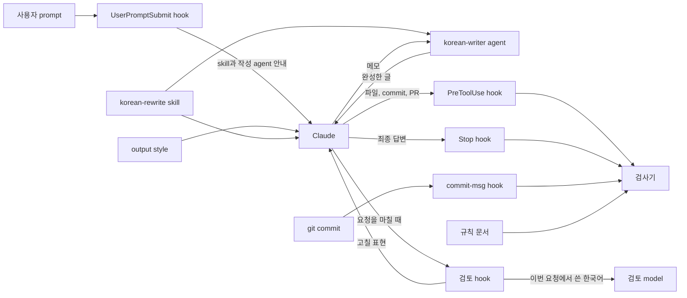

<h1 align="center">korean-rewrite</h1>

<p align="center">
  <strong>Claude Code에서 Claude가 번역투 대신 자연스러운 한국어를 쓰게 합니다.</strong>
</p>

<p align="center">
  <a href="LICENSE"></a>
  <a href="https://github.com/nerdkim/korean-rewrite/actions/workflows/gate.yml"></a>
  
  
</p>

korean-rewrite는 Claude Code를 쓰는 프로젝트에 한국어 작성 skill, 작성 agent, 문체 검사기, hook을 설치하는 도구입니다. 설치하면 skill이 Claude에게 번역투를 쓰지 말고 업무 문서처럼 격식 있는 문어체로 쓰라고 지시합니다. Claude가 쓴 글에서 검사기가 오류를 찾으면 hook은 그 글이 파일, commit, PR에 남지 않게 막습니다.

## 한눈에 보기

commit 메시지를 써 달라는 요청을 이 도구가 없는 프로젝트와 이 도구를 설치한 프로젝트에서 똑같이 Claude에게 보냈습니다.

**요청**

<!-- korean-style-quote -->

> 아래 변경 내용으로 커밋 메시지를 써 줘.  
>
> - 로그인 API에 rate limit 추가 (IP당 분당 10회)  
> - 한도를 넘으면 429 반환  
> - rate limit 테스트 추가  

<!-- /korean-style-quote -->

<table>
<tr>
<th width="50%">이 도구가 없는 프로젝트</th>
<th width="50%">이 도구를 설치한 프로젝트</th>
</tr>
<tr>
<td valign="top">

<!-- korean-style-quote -->

> ```
> 로그인 API에 IP별 rate limit 추가
>
> 로그인 엔드포인트에 IP별 요청 제한(분당 10회)을 적용한다.
> 한도를 넘은 요청에는 429 Too Many Requests를 반환한다.
>
> - 로그인 API에 IP 기반 rate limit 적용 (분당 10회)
> - 한도 초과 시 429 응답 반환
> - rate limit 동작 테스트 추가
> ```
>
> 영어로 쓰는 저장소라면 아래 버전을 쓰시면 됩니다.  
>
> ```
> Add per-IP rate limiting to login API
>
> Limit login requests to 10 per minute per IP address.
> Requests over the limit receive a 429 Too Many Requests response.
>
> - Apply IP-based rate limit (10 req/min) to login endpoint
> - Return 429 when the limit is exceeded
> - Add tests for rate limiting behavior
> ```

<!-- /korean-style-quote -->

</td>
<td valign="top">

<!-- korean-style-quote -->

> ```
> feat: login API에 rate limit 추가
>
> login API 요청 수를 IP마다 분당 10회로 제한합니다.
> 한도를 넘은 요청에는 429를 반환합니다.
> rate limit test를 추가했습니다.
> ```

<!-- /korean-style-quote -->

</td>
</tr>
</table>

- 이 도구가 없는 프로젝트의 답변은 `feat:` 같은 접두어가 없고 본문을 해라체로 썼습니다. code block 뒤에는 `영어로 쓰는 저장소라면 아래 버전을 쓰시면 됩니다.`라는 문장과 영어 commit 메시지를 덧붙였습니다.
- 설치한 프로젝트의 답변은 `feat: login API에 rate limit 추가`라는 제목과 합니다체 본문 세 문장만 code block에 담았습니다. 앞뒤에는 아무 말도 붙이지 않았습니다.
- 설치한 프로젝트의 답변에서 Claude는 요청의 `로그인`과 `테스트`를 IT 용어 표기 규칙에 따라 `login`, `test`로 썼습니다.

## 특징

- **번역투를 쓰지 않게 합니다.** skill에는 고칠 표현과 고친 예가 들어 있습니다. 예를 들어 `설정하는 것이 가능합니다`는 `설정할 수 있습니다`로 고칩니다. `요청에 대한 응답`처럼 사전에 오른 정상 용법은 그대로 둡니다.
- **답변도 업무 문서처럼 격식 있는 문어체로 쓰게 합니다.** 기본 말투는 합니다체이고 요청은 `~해 주십시오`로 끝냅니다. 설치할 때 해요체를 고를 수도 있습니다.
- **IT 용어는 영어 원어로 쓰게 합니다.** 개발자가 읽는 글에서는 `commit`, `deploy`, `server`처럼 쓰고 `커밋` 같은 음차와 `배포` 같은 번역어는 쓰지 않습니다. 이 표기는 업계 다수 관행이 아니라 이 도구가 정한 기본값입니다. 검사기의 IT 용어 규칙을 끄는 방법은 [설치와 사용](docs/usage.md)에 있습니다.
- **접속 부사를 앞뒤 관계에 맞게 고르게 합니다.** skill은 원인과 결과를 `그래서`로, 근거와 결론을 `따라서`로 잇게 합니다.
- **요청한 것만 쓰게 합니다.** skill은 머리말, 묻지 않은 제안, 요청에 없는 연도와 예시 코드를 넣지 말라고 지시합니다.
- **한글이 많은 글은 작성 agent가 씁니다.** 파일, commit 메시지, PR과 issue에 올리는 글에서 한 번에 쓰는 한글이 200자 이상이면 작업하던 Claude는 `korean-writer` agent에게 메모를 넘기고 이 agent가 쓴 글을 받아 사용합니다. 작성 agent가 쓴 글이 Claude가 직접 쓴 글보다 나은지는 아직 측정하지 않았습니다.
- **검사기가 오류를 찾으면 hook이 막고 요청을 마친 뒤에는 검토 model이 글을 다시 읽습니다.** 검사기는 model이나 network를 쓰지 않으므로 같은 글의 검사 결과가 늘 같습니다. 어색한 문장은 요청을 마친 뒤 검토 model이 잡지만 모두 찾지는 못합니다.

## 설치

Node.js 20 이상, npm, Git, Claude Code가 필요합니다.

Claude Code에서 다음과 같이 요청하면 Claude가 repository를 읽고 설치합니다.

> https://github.com/nerdkim/korean-rewrite repository를 읽고 이 프로젝트에 설치해 주십시오.

직접 설치하려면 프로젝트 root directory에서 다음 명령을 실행합니다.

```sh
npx -y github:nerdkim/korean-rewrite --target . --activate
node .korean-style/scripts/doctor.mjs
```

설치한 뒤에는 Claude Code를 재시작합니다. 말투는 `--register 해요체`처럼 고릅니다. 처음 설치할 때 이 option을 주지 않으면 Claude는 합니다체로 씁니다.

### 설치하면 바뀌는 것

- `.claude/settings.json`에 hook 다섯 개를 추가합니다.
- `.claude/agents/korean-writer.md`에 작성 agent를 만듭니다.
- 프로젝트에서 고른 output style이 없으면 `korean-style`을 고릅니다. `--activate`를 붙이면 이미 고른 output style도 `korean-style`로 바꿉니다.
- `attribution`의 `commit`과 `pr`에 값이 없으면 빈 값을 넣어 생성 표시를 붙이지 않게 합니다.
- `env`에 `CLAUDE_CODE_THINKING_DISPLAY_UPDATES` 값이 없으면 `0`을 넣습니다.
- Git repository에는 `commit-msg` hook도 설치합니다.

설치 script는 `attribution`과 `env`에서 프로젝트가 이미 정해 둔 값을 바꾸지 않습니다.

### 다시 설치하기

같은 설치 명령을 다시 실행하면 최신 버전으로 바뀝니다. 0.4.1까지의 기본 규칙은 IT 용어의 한글 음차를 검사하지 않았습니다. 새 기본 규칙에서는 개발자가 읽는 글에 쓴 한글 음차를 검사기가 오류로 잡습니다. 이 도구를 팀에서 쓰는 법과 제거하는 법은 [설치와 사용](docs/usage.md)에 있습니다.

## 쓰는 법

설치하고 Claude Code를 재시작하면 따로 할 일은 없습니다. skill을 직접 부르려면 메시지 맨 앞에 `/`와 skill 이름을 입력합니다.

| skill | 쓸 때 | 예 |
| --- | --- | --- |
| `korean-rewrite` | 한국어 글을 쓰거나 다듬을 때, 영어 문서를 한국어로 옮길 때 | `/korean-rewrite docs/guide.md를 자연스러운 한국어로 다듬어 주십시오` |
| `korean-style` | 검사 규칙을 확인하거나 표현이 어색한 이유를 찾을 때 | `/korean-style README.md에서 어색한 표현을 찾아 주십시오` |

검사기는 Claude 없이 직접 실행할 수 있습니다. 오류가 있으면 종료 코드 1로 끝나고 경고만 있으면 0으로 끝나며 파일은 고치지 않습니다.

```sh
node .korean-style/scripts/check-korean.mjs --file docs/guide.md
node .korean-style/scripts/check-korean.mjs --all
node .korean-style/scripts/check-korean.mjs --explain translationese
```

- **규칙 바꾸기.** `.korean-style/rules.md`의 `korean-style-rules` 블록을 고치면 Claude Code를 재시작하지 않아도 바로 적용되고 다시 설치해도 남습니다.
- **IT 용어 검사 끄기.** 규칙 문서에서 `banned-transliteration`, `ambiguous-transliteration`, `banned-translation` 세 키의 값을 비웁니다. 자세한 방법은 [설치와 사용](docs/usage.md)에 있습니다.
- **검토 hook 끄기와 검토 model 바꾸기.** `reviewer-model:`의 값을 비우면 검토 hook이 꺼집니다. 기본값과 바꿀 수 있는 값은 [검사 규칙](docs/rules.md)에 있습니다.
- **답변을 작성 agent에게 맡기기.** 기본 규칙에서는 Claude가 화면에 나오는 답변을 작성 agent에게 맡기지 않습니다. 맡기려면 `writer-agent-answer-min-hangul`의 값을 0보다 크게 정합니다. 그러면 답이 늦어집니다.
- **Codex와 Gemini CLI.** skill, output style, Claude Code hook이 동작하지 않지만 Git `commit-msg` hook은 어느 프로그램으로 commit하든 commit 메시지를 검사합니다. 같은 기준을 따르게 하는 방법은 [설치와 사용](docs/usage.md)에 있습니다.

자세한 내용은 [설치와 사용](docs/usage.md)과 [검사 규칙](docs/rules.md)에 있습니다.

## 설치 전후 비교

요청 열두 가지를 Claude Opus 5.5에 보냈습니다. 요청마다 이 도구를 설치한 프로젝트에서 두 번, 설치하지 않은 프로젝트에서 두 번 보냈고 요청을 보낼 때마다 새 session을 열었습니다. Claude Code 2.1.310에서 effort를 medium으로 두고 2026년 11월 6일(한국 시간)에 실행했습니다. 두 프로젝트에서 모두 Claude가 쓸 수 있는 도구는 Skill, Read, Bash뿐이었습니다.

0.4.1을 release한 뒤 skill, output style, 검사 규칙을 개편했습니다. 이 비교에서는 개편한 버전을 설치했습니다. 평가를 실행한 뒤에도 skill과 output style을 고쳤으며 고친 예는 [설치 전후 예시](docs/examples.md)의 앞부분에 있습니다. 작성 agent와 검토 hook도 설치되어 있었지만 이 비교의 답변에는 영향을 주지 않았습니다. 그 이유도 같은 곳에 있습니다.

| 항목 | 이 도구가 없는 프로젝트 | 이 도구를 설치한 프로젝트 |
| --- | --- | --- |
| skill을 거친 답변 | 24개 중 0개 | 24개 중 24개 |
| Stop hook이 다시 쓰게 한 답변 | 24개 중 0개 | 24개 중 1개 |
| 검사기가 오류를 찾은 답변 | 24개 중 17개 | 24개 중 0개 |
| 검사기가 해요체 어미를 찾은 답변 | 24개 중 16개 | 24개 중 0개 |
| 검사기가 IT 용어의 한글 음차를 찾은 답변 | 24개 중 18개 | 24개 중 4개 |
| 검사기가 IT 용어의 번역어를 찾은 답변 | 24개 중 6개 | 24개 중 0개 |
| emoji가 들어간 답변 | 24개 중 5개 | 24개 중 0개 |
| 가운뎃점이 들어간 답변 | 24개 중 3개 | 24개 중 0개 |
| Claude Code 생성 표시가 들어간 답변 | 24개 중 2개 | 24개 중 0개 |
| 답변 길이 합계 | 20,242자 | 12,178자 |
| 처음 보낸 요청에서 답변 하나에 든 평균 비용 | 0.045달러 | 0.215달러 |
| 같은 요청을 다시 보냈을 때 답변 하나에 든 평균 비용 | 0.018달러 | 0.158달러 |
| 답변 하나를 받는 데 걸린 평균 시간 | 10.6초 | 12.9초 |

- 두 프로젝트의 답변을 모두 합니다체 기본 규칙으로 검사했으므로 해요체로만 쓴 답변도 오류가 있는 답변으로 집계했습니다.
- 설치한 프로젝트에서 검사기가 IT 용어의 한글 음차를 찾은 답변은 4개이고 그 가운데 2개는 사용자가 준 문단을 다듬는 요청의 답변입니다. 이 두 답변은 원문의 `캐시`, `서버`, `데이터`를 한글 그대로 두었습니다. 사용자가 준 글의 표기를 바꾸지 않는다는 skill 규칙에 맞는 처리입니다.
- 설치한 프로젝트는 비용과 시간이 더 들었습니다. 처음 보낸 요청에서 답변 하나에 든 비용은 0.3.2 버전을 설치한 지난 평가의 0.123달러에서 0.215달러로 늘었습니다. SKILL.md 파일이 17,011 byte에서 40,202 byte로 길어졌기 때문으로 보이지만 확인하지는 않았습니다.
- Stop hook이 다시 쓰게 한 답변 1건은 `확인하십시오`처럼 사람에게 명령하는 어미를 쓴 답변이었습니다. Claude는 이런 어미를 `확인해 주십시오`처럼 요청하는 어미로 고쳐 답변을 다시 썼습니다.

검사기가 집계할 수 없는 항목은 사람이 두 프로젝트의 답변 48개를 모두 읽고 집계했습니다.

| 항목 | 이 도구가 없는 프로젝트 | 이 도구를 설치한 프로젝트 |
| --- | --- | --- |
| 머리말이 있는 답변 | 24개 중 7개 | 24개 중 5개 |
| 덧붙인 말이 있는 답변 | 24개 중 17개 | 24개 중 6개 |
| 요청에 없는 내용이 있는 답변 | 24개 중 15개 | 24개 중 2개 |

- 머리말은 요청한 글 앞에 붙여 답변 자체를 소개하거나 이어질 순서를 알리는 문장입니다.
- 덧붙인 말은 요청한 글 뒤에 붙인 제안, 질문, 설명입니다.
- 요청에 없는 내용은 연도, 요일, test 목록, 예시 코드, 명령 출력처럼 사용자가 주지 않았는데 답변에 넣은 사실, 목록, 코드입니다.

<!-- -->

- 설치한 프로젝트에서 덧붙인 말이 있는 답변 6개 가운데 4개는 요청에 없어서 넣지 않은 내용을 설명했습니다. skill은 고르면서 뺀 내용을 설명하는 문단을 덧붙이지 말라고 합니다.
- 요청 열두 가지 가운데 다섯 가지는 요청 원문이나 요청이 쓰게 하는 글의 구절이 skill 예문에 그대로 나옵니다. 나머지 일곱 가지 요청의 답변만 집계하면 덧붙인 말이 있는 답변은 이 도구가 없는 프로젝트에서 14개 중 12개, 설치한 프로젝트에서 14개 중 5개였습니다. 요청에 없는 내용이 있는 답변은 이 도구가 없는 프로젝트에서 14개 중 11개, 설치한 프로젝트에서 14개 중 2개였습니다. 그러나 머리말이 있는 답변은 두 프로젝트 모두 14개 중 4개로 차이가 없었습니다.
- 이 도구는 기술 설명이 맞는지 확인하지 않습니다. 설치한 프로젝트의 답변에도 틀린 기술 설명이 있었습니다.

### 다른 예시

<details>
<summary><b>PR review comment 쓰기</b></summary>

**요청**

<!-- korean-style-quote -->

> 동료가 올린 PR에 남길 리뷰 코멘트를 써 줘. 내가 찾은 문제는 두 가지야.  
>
> - 외부 API 재시도 루프에 최대 횟수가 없어서 API가 계속 실패하면 요청이 끝나지 않음  
> - catch 블록에서 에러를 로그도 남기지 않고 무시함  

<!-- /korean-style-quote -->

<table>
<tr>
<th width="50%">이 도구가 없는 프로젝트</th>
<th width="50%">이 도구를 설치한 프로젝트</th>
</tr>
<tr>
<td valign="top">

<!-- korean-style-quote -->

> PR에 바로 붙여 넣을 수 있게 두 코멘트로 나눠 썼어요.  
>
> ---  
>
> **1. 재시도 루프에 최대 횟수가 없어요**  
>
> 외부 API 재시도 루프에 종료 조건이 없어서, API가 장애 등으로 계속 실패하면 이 요청이 끝나지 않을 것 같아요. 그동안 요청을 처리하는 스레드나 커넥션을 계속 붙잡고 있게 되고, 장애가 길어지면 실패한 요청이 쌓여서 우리 서비스까지 같이 느려지거나 멈출 수 있어요.  
>
> 이렇게 바꾸면 좋겠어요.  
> - 최대 재시도 횟수를 정해 주세요(예: 3회). 넘으면 에러를 던지거나 호출한 쪽에 실패를 알려 주세요.  
> - 재시도 간격에 지수 백오프를 넣으면 장애 중인 API에 부담도 덜 줄 수 있어요.  
> - 4xx처럼 다시 보내도 성공할 수 없는 에러는 바로 실패로 처리하면 좋겠어요.  
>
> ```
> for attempt in 1..MAX_RETRIES:
>     try:
>         return callApi()
>     catch (e):
>         if attempt == MAX_RETRIES or !isRetryable(e):
>             throw e
>         sleep(baseDelay * 2^(attempt - 1))
> ```
>
> ---  
>
> **2. catch 블록에서 에러를 그냥 무시하고 있어요**  
>
> 지금은 catch 블록에서 에러를 잡은 뒤 로그도 없이 넘어가고 있어요. 이러면 운영 중에 문제가 생겨도 기록이 남지 않아서 원인을 찾기가 아주 어려워요. 겉으로는 정상처럼 보이는데 데이터가 빠지는 식의 문제로 이어질 수도 있고요.  
>
> 이렇게 바꾸면 좋겠어요.  
> - 최소한 에러 메시지와 스택 트레이스를 로그로 남겨 주세요. 요청 ID 같은 관련 정보도 같이 남기면 더 좋아요.  
> - 여기서 처리할 수 없는 에러라면 다시 던져서 위에서 처리하게 해 주세요.  
> - 일부러 무시하는 경우라면 왜 무시해도 괜찮은지 주석으로 남겨 주세요.  
>
> ---  
>
> 실제 코드의 언어와 쓰고 있는 로깅·재시도 라이브러리를 알려 주시면 예시 코드를 그 코드에 맞게 바꿔 드릴게요.  

<!-- /korean-style-quote -->

</td>
<td valign="top">

<!-- korean-style-quote -->

> **1. 재시도 loop의 최대 횟수**  
>
> > 외부 API를 다시 호출하는 loop에 최대 재시도 횟수가 없습니다. 그래서 API가 계속 실패하면 요청이 끝나지 않습니다. 최대 재시도 횟수를 정해 주십시오. 그 횟수를 넘기면 loop를 끝내고 호출한 쪽에 실패를 알리도록 수정해 주십시오.  
>
> **2. `catch` block에서 오류를 무시하는 문제**  
>
> > `catch` block이 오류를 잡은 뒤 log를 남기지 않고 그대로 무시합니다. 그래서 이 부분에서 문제가 생겨도 원인을 추적할 수 없습니다. 최소한 오류 내용을 log로 남기도록 수정해 주십시오.  

<!-- /korean-style-quote -->

</td>
</tr>
</table>

- 이 도구가 없는 프로젝트의 답변은 `PR에 바로 붙여 넣을 수 있게 두 코멘트로 나눠 썼어요.`라는 해요체 머리말로 시작했고 코멘트도 해요체로만 썼습니다.
- 이 답변은 사용자가 찾지 않은 지적 두 가지와 pseudo code를 넣었고 끝에는 예시 코드를 바꿔 주겠다는 제안을 덧붙였습니다.
- 설치한 프로젝트의 답변은 문제마다 제목을 달고 문제, 영향, 고칠 방향만 합니다체로 썼습니다. 다만 같은 요청을 다시 보냈을 때 받은 답변은 `아래 두 코멘트를 해당 코드 줄에 각각 남기시면 됩니다.`라는 머리말로 시작했습니다.

</details>

<details>
<summary><b>장애 메모로 팀 Slack에 공유할 요약 쓰기</b></summary>

**요청**

<!-- korean-style-quote -->

> 아래 장애 메모로 팀 슬랙 채널에 공유할 요약을 써 줘.  
>
> - 14:05부터 결제 API가 502 반환  
> - 원인: 어제 배포에서 DB 커넥션 풀 최대 연결 수가 100이 아니라 10으로 들어감  
> - 14:32 롤백, 14:40 오류율 정상화  
> - 장애 동안 결제 요청의 약 3% 실패  
> - 후속 조치: 커넥션 풀 포화 알림 추가, 배포 파이프라인에 설정값 검증 단계 추가  

<!-- /korean-style-quote -->

<table>
<tr>
<th width="50%">이 도구가 없는 프로젝트</th>
<th width="50%">이 도구를 설치한 프로젝트</th>
</tr>
<tr>
<td valign="top">

<!-- korean-style-quote -->

> 슬랙에 바로 올릴 수 있게 정리했습니다.  
>
> ---  
>
> **:rotating_light: [장애 공유] 결제 API 502 오류 (해결 완료)**  
>
> **요약**  
> 14:05부터 14:40까지 약 35분 동안 결제 API가 502 오류를 반환했습니다. 14:32에 롤백했고, 14:40에 오류율이 정상으로 돌아왔습니다.  
>
> **영향**  
> • 장애 동안 결제 요청의 약 3% 실패  
>
> **원인**  
> • 어제 배포에서 DB 커넥션 풀 최대 연결 수가 `100`이 아니라 `10`으로 잘못 들어갔습니다.  
> • 커넥션이 부족해지면서 요청을 처리하지 못해 502가 발생했습니다.  
>
> **타임라인**  
> • 14:05 결제 API 502 발생 시작  
> • 14:32 롤백  
> • 14:40 오류율 정상화  
>
> **후속 조치**  
> • 커넥션 풀 포화 알림 추가  
> • 배포 파이프라인에 설정값 검증 단계 추가  
>
> 궁금한 점은 이 스레드에 남겨 주세요. :pray:  
>
> ---  
>
> 메모에 담당자와 후속 조치 완료 예정일이 없어서 넣지 않았습니다. 두 가지를 정해 두셨다면 후속 조치 항목에 함께 적어 두는 게 좋습니다.  

<!-- /korean-style-quote -->

</td>
<td valign="top">

<!-- korean-style-quote -->

> *[장애 공유] 결제 API 502 오류*  
>
> • *발생:* 14:05부터 결제 API가 502 오류를 반환했습니다.  
> • *영향:* 장애 동안 결제 요청의 약 3%가 실패했습니다.  
> • *원인:* 어제 deploy에서 DB connection pool의 최대 연결 수가 100이 아니라 10으로 설정되었습니다.  
> • *조치:* 14:32에 rollback했습니다. 14:40에 오류율이 정상으로 돌아왔습니다.  
> • *후속 조치:* connection pool 포화 알림을 추가하겠습니다. deploy pipeline에도 설정값 검증 단계를 추가하겠습니다.  

<!-- /korean-style-quote -->

</td>
</tr>
</table>

- 이 도구가 없는 프로젝트의 답변은 머리말로 시작했고 Slack emoji 코드를 넣었습니다. 원인 항목에는 메모에 없는 설명을 추정이라고 밝히지 않고 넣었습니다. Slack 글 뒤에는 담당자와 완료 예정일을 적어 두라는 문단을 덧붙였습니다.
- 설치한 프로젝트의 답변은 발생, 영향, 원인, 조치, 후속 조치를 항목 이름으로 붙인 다섯 줄을 합니다체로 썼고 메모에 없는 내용은 넣지 않았습니다.
- 요청 원문의 `커넥션 풀`, `파이프라인`은 skill 예문에도 나옵니다. 따라서 `connection pool`, `pipeline`이라는 표기는 skill 예문 때문일 수 있습니다.

</details>

나머지 요청과 답변은 [설치 전후 예시](docs/examples.md)에, 다시 실행하는 방법은 [다시 실행하기](docs/examples.md#다시-실행하기)에 있습니다. 숫자는 저장한 결과로 `npm run eval -- --summary`를 실행해 다시 집계할 수 있습니다. 평가를 다시 실행하면 답변이 달라지므로 숫자도 달라질 수 있습니다.

## 동작 원리

이 도구는 Claude가 한국어를 쓰기 전에 기준을 주고 쓴 뒤에 글을 검사합니다.



**쓰기 전.** Claude는 session에서 처음 한국어를 쓰기 전에 `korean-rewrite` skill을 한 번 부릅니다. 사용자가 prompt를 보낼 때마다 UserPromptSubmit hook은 Claude가 이 session에서 skill을 불렀는지 확인하고 그에 맞는 안내를 Claude에게 전합니다.

**쓴 뒤.** Claude가 파일에 쓰거나 `git commit`, `gh pr`, `gh issue`를 실행하기 직전에 PreToolUse hook이 글을 검사하고 오류가 있으면 막습니다. Claude가 답변을 마치면 Stop hook이 답변을 검사해 오류가 있으면 한 번 다시 쓰게 합니다.

**요청을 마친 뒤.** Claude가 요청을 마치면 검토 hook이 그 요청에서 Claude가 쓴 한국어를 검토 model에게 보냅니다. 검토 hook은 background에서 실행되므로 답변이 늦어지지 않습니다. 파일, commit 메시지, PR과 issue 글에 대한 지적은 Claude Code가 Claude에게 전달하고, 답변에 대한 지적은 다음 요청 때 hook이 Claude에게 알립니다.

자세한 내용은 [동작 원리](docs/how-it-works.md)에 있습니다.

## 구조

설치 script는 이 repository의 파일을 프로젝트에 복사하고 프로젝트 설정에 hook을 등록합니다.

| 구성 요소 | 내용 | 이 repository의 경로 | 설치한 프로젝트의 경로 |
| --- | --- | --- | --- |
| `korean-rewrite` skill | 한국어를 쓰는 순서와 고칠 표현 | `skill/korean-rewrite/` | `.claude/skills/korean-rewrite/` |
| `korean-style` skill | 검사 규칙을 확인하고 어색한 표현의 원인을 찾는 방법 | `skill/korean-style/` | `.claude/skills/korean-style/` |
| output style | 말투와 기본 원칙 | `output-styles/korean-style.md` | `.claude/output-styles/korean-style.md` |
| `korean-writer` agent | 메모를 받아 한국어 글을 쓰는 agent | `agents/korean-writer.md` | `.claude/agents/korean-writer.md` |
| 규칙 문서 | 검사할 표현과 규칙마다 정한 등급 | `docs/rules.md` | `.korean-style/rules.md` |
| 검사기 | 규칙 문서대로 글을 검사하는 프로그램 | `scripts/check-korean.mjs`, `scripts/lib/` | `.korean-style/scripts/` |
| Claude Code hook | prompt를 보낼 때 안내하고 도구 실행 직전과 답변을 마칠 때 검사하는 script | `scripts/hooks/` | `.korean-style/scripts/hooks/`, `.claude/settings.json` |
| 검토 hook | 요청을 마친 뒤 Claude가 그 요청에서 쓴 한국어를 검토 model에게 보내 다시 읽게 하는 script | `scripts/hooks/review.mjs`, `scripts/lib/review.mjs` | `.korean-style/scripts/hooks/review.mjs`, `.claude/settings.json` |
| Git hook | commit 메시지를 검사하는 script | `scripts/hooks/commit-msg.mjs` | `.korean-style/scripts/hooks/commit-msg.mjs`, `.git/hooks/commit-msg` |
| doctor | 설치 상태를 확인하는 script | `scripts/doctor.mjs` | `.korean-style/scripts/doctor.mjs` |

규칙 문서와 프로젝트 설정처럼 팀이 함께 쓸 파일은 repository에 commit합니다. 설치 script는 검사기, hook script, skill, output style, 작성 agent의 경로를 `.gitignore`에 넣으므로 repository를 clone한 팀원도 설치 명령을 한 번 실행해야 합니다.

규칙 module 목록은 [규칙 module](docs/how-it-works.md#규칙-module)에 있습니다.

## 제약

- hook은 Claude가 skill을 불렀는지만 확인하고 skill에 적힌 순서를 모두 따랐는지는 확인하지 않습니다.
- 검사기는 규칙 문서에 적힌 형태만 찾으므로 요청에 없는 내용과 공개하면 안 되는 정보는 잡지 못합니다.
- 검사기는 답변이 개발자에게 하는 말인지 이용자 공지 초안인지 가려내지 못하므로 답변에서는 IT 용어의 한글 음차를 경고로만 알립니다.
- Stop hook은 답변이 화면에 나온 뒤에 실행되므로 다시 쓰기 전의 답변도 화면에 남습니다. 다시 쓴 답변은 Stop hook이 다시 검사하지 않습니다.
- 검토 model도 번역투를 모두 찾지는 못합니다.
- 검토 hook은 `claude` 명령으로 검토 model을 부르므로 PATH에 `claude` 명령이 있어야 하고 부를 때마다 Claude Code 계정 사용량이 늘어납니다.

나머지 제약은 [제약](docs/limits.md)에 있습니다.

## 문서

| 문서 | 내용 |
| --- | --- |
| [설치와 사용](docs/usage.md) | 설치 option, 설치되는 파일, 규칙 바꾸는 법, 팀에서 쓰는 법, 제거하는 법, 문제 해결 |
| [동작 원리](docs/how-it-works.md) | hook이 언제 무엇을 검사하고 막는지, 검사기가 글을 처리하는 순서 |
| [검사 규칙](docs/rules.md) | 규칙 목록과 규칙을 오류와 경고로 나눈 근거 |
| [한국어 작성 원칙](docs/writing.md) | skill이 따르는 원칙과 출처 |
| [제약](docs/limits.md) | 이 도구가 하지 못하는 것 |
| [설치 전후 예시](docs/examples.md) | 요청 열두 가지마다 두 프로젝트에서 받은 답변과 그 차이 |

## 기여하기

- bug와 제안은 [Issues](https://github.com/nerdkim/korean-rewrite/issues)에 남겨 주십시오. pull request를 환영합니다.
- 작업 지침은 `CLAUDE.md`에 있습니다. `AGENTS.md`와 `GEMINI.md`는 이 파일을 가리키는 symlink입니다.
- 이 repository를 Claude Code로 열면 `.claude/settings.json`에 등록한 hook이 `scripts/hooks/`의 script를 바로 실행하므로 고친 hook과 규칙을 그 자리에서 써 볼 수 있습니다.
- 동작을 바꾸면 `test/`에 회귀 test를 추가하고, 검사기가 잡으면 안 되는 문장도 넣습니다.
- 검사 규칙과 등급(오류나 경고)은 `docs/rules.md`에서 정하고 코드에 정책 값을 숨기지 않습니다. 작성 규칙은 `skill/korean-rewrite/SKILL.md`에, 근거와 출처는 `docs/writing.md`에 있습니다.
- commit하기 전에 `npm run gate`를 실행합니다. GitHub Actions도 push와 pull request마다 Node.js 20, 22, 24, 26에서 실행하며 `package.json`에 dependency를 추가하면 실패합니다.
- 실제 model로 하는 평가는 유료 API를 쓰므로 `npm run eval -- --run`으로 따로 실행하고, 결과는 `.eval/`에만 두고 Git에 넣지 않습니다.

## 라이선스

[MIT](LICENSE)
