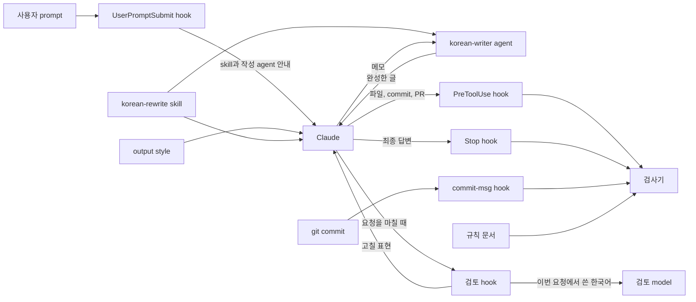

<h1 align="center">korean-rewrite</h1>

<p align="center">
  <strong>Claude Code용 한국어 글쓰기 skill과 hook 묶음입니다.</strong><br>
  Claude가 번역투 대신 자연스러운 한국어를 쓰게 합니다.
</p>

<p align="center">
  <a href="LICENSE"></a>
  <a href="https://github.com/nerdkim/korean-rewrite/actions/workflows/gate.yml"></a>
  
  
</p>

korean-rewrite는 Claude Code에서 Claude가 번역투 대신 자연스러운 한국어를 쓰게 하는 도구입니다. 설치하면 Claude는 답변을 포함한 모든 글을 업무 문서처럼 격식 있는 문어체로 씁니다. 이 도구는 Claude Code용 skill 2개, subagent 1개, output style 1개, Claude Code hook 5개, Git `commit-msg` hook, 문체 검사기로 이루어져 있습니다. 설치 script 하나가 이 구성 요소를 모두 프로젝트에 넣습니다.

설치 script는 구성 요소를 프로젝트의 `.claude/`와 `.korean-style/` directory에 복사합니다. Claude Code hook은 `.claude/settings.json`에 등록하고 Git `commit-msg` hook은 Git의 hook directory(기본값 `.git/hooks/`)에 설치합니다. 프로젝트마다 설치하며 사용자 전역 설정 directory(`~/.claude/`)에는 설치하지 않습니다. Claude Code의 plugin 명령(`/plugin install`)으로는 설치할 수 없습니다.

| 종류 | 이름 | 하는 일 |
| --- | --- | --- |
| skill | `korean-rewrite` | Claude가 session에서 처음 한국어를 쓰기 전에 부르는 작성 규칙입니다. 번역투의 정의, 고칠 표현과 고친 예, 말투, IT 용어 표기 규칙을 담았습니다. |
| skill | `korean-style` | 검사 규칙을 확인하거나 어색한 표현의 원인을 찾을 때 부릅니다. |
| subagent | `korean-writer` | 파일, commit 메시지, PR과 issue에 올리는 글에서 한 번에 쓰는 한글이 200자 이상이면 Claude가 이 agent에게 메모를 넘겨 글을 맡깁니다. |
| output style | `korean-style` | 답변의 말투와 기본 원칙을 정합니다. |
| Claude Code hook | `UserPromptSubmit`, `PreToolUse`, `Stop`, `SubagentStop` | 설치 script는 이 네 시점에 실행되는 hook 5개를 등록합니다. `UserPromptSubmit`에 1개, `PreToolUse`에 1개, `Stop`에 2개, `SubagentStop`에 1개입니다. hook은 Claude가 skill을 먼저 부르게 합니다. Claude가 파일, commit 메시지, PR과 issue에 쓰는 글과 답변은 hook이 검사기로 검사해 오류가 있으면 막거나 다시 쓰게 합니다. 요청을 마친 뒤에는 그 요청에서 쓴 한국어를 검토 model(기본값 Sonnet)에게 다시 읽힙니다. |
| Git hook | `commit-msg` | 어느 프로그램으로 commit하든 commit 메시지를 검사합니다. |
| 검사기 | `check-korean.mjs` | 규칙 문서 `.korean-style/rules.md`에 적힌 표현을 찾는 Node.js script입니다. model과 network를 쓰지 않으므로 같은 글은 늘 같은 결과가 나옵니다. |

구성 요소마다 설치되는 경로는 [구조](#구조) 절에 있습니다.

## 빠르게 시작하기

Node.js 20 이상, npm, Git, Claude Code가 필요합니다. 명령은 macOS, Linux, WSL의 shell에서 실행합니다. 이 도구는 다른 npm package를 설치하지 않습니다.

설치하는 방법은 Claude Code에게 맡기는 방법과 terminal에서 직접 명령을 실행하는 방법 두 가지입니다. 어느 방법으로 설치하든 설치한 뒤에 Claude Code를 재시작해야 합니다. 실행 중인 session을 끝내고 새 session을 열어야 skill과 hook이 적용됩니다.

### Claude Code에게 설치 맡기기

설치할 프로젝트의 root directory에서 Claude Code를 열고 아래 요청을 그대로 보내 주십시오.

```text
이 프로젝트에 korean-rewrite(https://github.com/nerdkim/korean-rewrite)를 설치해 주십시오. 프로젝트 root directory에서 `npx -y github:nerdkim/korean-rewrite --target . --activate`를 실행한 뒤 `node .korean-style/scripts/doctor.mjs`로 설치 상태를 확인해 주십시오.
```

Claude Code가 명령을 실행해도 되는지 물으면 허용해 주십시오. Claude가 두 명령을 실행하고 설치 결과와 점검 결과를 알려 줍니다. 그 뒤에 Claude Code를 재시작해 주십시오.

### 직접 설치하기

1. terminal에서 설치할 프로젝트의 root directory로 이동합니다. 프로젝트 root directory에 `.git`이 없으면 설치 script는 `.gitignore` 항목을 추가하지 않고 `commit-msg` hook도 설치하지 않습니다. 새 프로젝트이면 먼저 `git init`을 실행합니다.
2. 다음 명령을 실행합니다.

   ```sh
   npx -y github:nerdkim/korean-rewrite --target . --activate
   node .korean-style/scripts/doctor.mjs
   ```

   첫 줄은 이 repository를 받아 설치 script를 실행합니다. 둘째 줄의 doctor는 설치 상태를 항목마다 점검하고 점검 결과의 마지막 줄에 `실패 0개, 주의 0개`처럼 개수를 출력합니다. 실패한 항목이 있으면 종료 코드 1로 끝납니다. 해결 방법은 [설치와 사용](docs/usage.md#문제-해결)에 있습니다.
3. Claude Code를 재시작합니다.

npx를 쓸 수 없으면 repository를 내려받아 설치 script를 직접 실행합니다.

```sh
git clone --depth 1 https://github.com/nerdkim/korean-rewrite.git /tmp/korean-rewrite
node /tmp/korean-rewrite/scripts/install.mjs --target "$PWD" --activate
```

처음 설치할 때 말투 option을 주지 않으면 Claude는 합니다체로 씁니다. 해요체로 쓰게 하려면 설치 명령 끝에 `--register 해요체`를 붙입니다.

`--activate`를 붙이면 프로젝트에서 이미 고른 output style도 `korean-style`로 바뀝니다. 이미 고른 output style을 그대로 두려면 `--activate`를 뺍니다. 다른 option은 [설치와 사용](docs/usage.md#설치-option)에 있습니다.

### 써 보기

Claude Code를 재시작한 뒤 아래 [설치 전후 비교](#설치-전후-비교) 절의 요청을 그대로 보내 주십시오. Claude는 글을 쓰기 전에 `korean-rewrite` skill을 부릅니다. 받은 글은 그 절에 실은 두 답변과 비교해 볼 수 있습니다.

이미 있는 문서를 다듬게 하려면 메시지 맨 앞에 `/korean-rewrite`를 입력합니다. 예를 들어 `/korean-rewrite docs/guide.md를 자연스러운 한국어로 다듬어 주십시오`처럼 입력합니다.

## 설치 전후 비교

아래 메모를 주고 팀 기술 블로그에 올릴 짧은 글을 써 달라고 Claude에게 요청했습니다. 요청은 이 도구가 없는 프로젝트와 이 도구를 설치한 프로젝트에서 각각 두 번 보냈습니다. 아래 표에는 프로젝트마다 첫 번째 답변을 글자 그대로 실었습니다.

**요청**

<!-- korean-style-quote -->

> 아래 메모로 팀 기술 블로그에 올릴 짧은 글을 써 줘.  
>
> - 주문 목록 API 응답 시간이 평균 1.2초였음  
> - 원인: 주문마다 상품 정보를 따로 조회하는 N+1 쿼리  
> - 상품 정보를 한 번에 가져오도록 쿼리를 고치고, 자주 조회하는 상품 정보는 Redis에 캐시함  
> - 평균 응답 시간이 180ms로 줄어듦  
> - 남은 과제: 상품 정보가 바뀌면 캐시를 언제 지울지 정해야 함  

<!-- /korean-style-quote -->

<table>
<tr>
<th width="50%">이 도구가 없는 프로젝트</th>
<th width="50%">이 도구를 설치한 프로젝트</th>
</tr>
<tr>
<td valign="top">

<!-- korean-style-quote -->

> # 주문 목록 API 응답 시간을 1.2초에서 180ms로 줄인 이야기  
>
> ## 문제: 느린 주문 목록 API  
>
> 주문 목록 API의 평균 응답 시간은 1.2초였습니다. 목록 하나를 불러오는 데 1초가 넘게 걸리니 사용자도 지연을 바로 느낄 수 있었습니다.  
>
> ## 원인: N+1 쿼리  
>
> 원인은 전형적인 **N+1 쿼리**였습니다. 주문 목록을 한 번 조회한 뒤, 각 주문에 들어 있는 상품 정보를 주문마다 따로 조회하고 있었습니다.  
>
> ```sql
> -- 주문 목록 조회 (1번)
> SELECT * FROM orders WHERE ...;
>
> -- 주문마다 상품 정보 조회 (N번)
> SELECT * FROM products WHERE id = ?;
> SELECT * FROM products WHERE id = ?;
> ...
> ```
>
> 주문이 많을수록 쿼리 수도 그만큼 늘어나서 응답 시간이 길어졌습니다.  
>
> ## 해결: 쿼리 정리와 Redis 캐시  
>
> 두 가지를 바꿨습니다.  
>
> **1. 상품 정보를 한 번에 조회**  
>
> 주문마다 상품을 따로 조회하지 않고, 필요한 상품 정보를 쿼리 한 번으로 모두 가져오도록 고쳤습니다.  
>
> ```sql
> SELECT * FROM products WHERE id IN (?, ?, ?, ...);
> ```
>
> 이제 주문 수가 늘어도 쿼리 수는 늘어나지 않습니다.  
>
> **2. 자주 조회하는 상품 정보를 Redis에 캐시**  
>
> 여러 주문에서 반복해서 조회되는 상품 정보는 Redis에 캐시했습니다. 캐시에 있는 상품은 DB를 거치지 않고 바로 응답합니다.  
>
> ## 결과  
>
> | 항목 | 개선 전 | 개선 후 |  
> |---|---|---|  
> | 평균 응답 시간 | 1.2초 | 180ms |  
>
> 평균 응답 시간이 **1.2초에서 180ms로 약 85% 줄었습니다.**  
>
> ## 남은 과제: 캐시는 언제 지울까  
>
> 캐시를 도입하면서 새로운 문제가 생겼습니다. 상품 정보가 바뀌었을 때 **캐시를 언제 지울지** 아직 정하지 않았습니다. 이 부분을 정하지 않으면 사용자가 바뀌기 전의 가격이나 상품명을 보게 될 수 있습니다.  
>
> 검토 중인 방법은 다음과 같습니다.  
>
> - **상품 수정 시점에 캐시 삭제**: 데이터가 가장 정확하지만, 상품을 수정하는 모든 경로에서 캐시를 지워야 합니다.  
> - **TTL(만료 시간) 설정**: 구현이 간단하지만, 만료 전까지는 이전 정보가 보일 수 있습니다.  
> - **두 방법 함께 쓰기**: 수정 시점에 캐시를 지우고, 혹시 놓친 경우를 대비해 TTL도 함께 둡니다.  
>
> 어떤 방식을 골랐고 운영해 보니 어땠는지는 다음 글에서 공유하겠습니다.  
>
> ---  
>
> 메모에 없는 내용인 SQL 예시와 캐시 무효화 방법 세 가지는 글의 흐름을 위해 넣었습니다. 85%는 메모의 수치(1.2초 → 180ms)로 계산한 값입니다. 실제 사용하는 ORM 코드나 이미 검토한 방법이 있으면 그 내용으로 바꿔 주세요.  

<!-- /korean-style-quote -->

</td>
<td valign="top">

<!-- korean-style-quote -->

> # 주문 목록 API 응답 시간을 1.2초에서 180ms로 줄였습니다  
>
> 주문 목록 API의 평균 응답 시간이 1.2초였습니다. 원인은 주문마다 상품 정보를 따로 조회하는 N+1 query였습니다. 주문 목록을 조회한 뒤 주문 수만큼 상품 query를 추가로 실행했습니다. 그래서 주문이 많을수록 database를 호출하는 횟수도 늘어났습니다.  
>
> ## 개선한 내용  
>
> 먼저 상품 정보를 한 번에 가져오도록 query를 수정했습니다. 이제 주문마다 상품을 조회하지 않고 목록에 필요한 상품 정보를 query 한 번으로 가져옵니다. 이와 함께 자주 조회하는 상품 정보는 Redis에 cache했습니다.  
>
> ## 결과  
>
> 평균 응답 시간이 1.2초에서 180ms로 줄었습니다.  
>
> ## 남은 과제  
>
> 상품 정보가 바뀌었을 때 cache를 언제 지울지 아직 정하지 않았습니다. 이 부분은 앞으로 정해야 합니다.  

<!-- /korean-style-quote -->

</td>
</tr>
</table>

아래 목록 가운데 메모에 없는 내용, 덧붙인 말, 표와 굵은 글씨, 말투는 사람이 답변 네 개를 읽고 확인했습니다. 답변 길이, 비용, 시간은 평가 script가 저장한 실행 기록에서 가져왔습니다.

- `메모에 없는 내용`과 `덧붙인 말`은 다음 기준으로 판단했습니다. `메모에 없는 내용`은 메모에 적히지 않은 사실, 수치, 코드를 뜻합니다. `덧붙인 말`은 요청한 글 뒤에 붙인 설명과 제안을 뜻합니다.
- 이 도구가 없는 프로젝트의 두 답변은 합쳐서 2,484자였습니다. 두 답변 모두 메모에 없는 내용을 넣었습니다. 첫 번째 답변은 SQL 예시 두 개와 cache를 지우는 방법 세 가지를 넣었습니다. 두 번째 답변은 `쿼리 로그를 살펴보니`라는 조사 과정을 넣었고 독자에게 권하는 말을 담은 `## 마치며` 절도 넣었습니다.
- 이 도구가 없는 프로젝트의 두 답변은 모두 메모의 1.2초와 180ms로 계산한 `약 85%`를 넣었습니다. 두 답변 모두 cache를 지우는 방법을 정한 뒤 다음 글에서 공유하겠다고 썼습니다. 평균 응답 시간 한 줄만 담은 표도 두 답변에 모두 있습니다. 굵은 글씨는 첫 번째 답변에 8번, 두 번째 답변에 6번 썼습니다.
- 이 도구가 없는 프로젝트의 두 답변은 글 뒤에 가로줄을 긋고 그 아래에 말을 덧붙였습니다. 첫 번째 답변은 메모에 없는 SQL 예시와 방법 세 가지를 넣었다고 밝힌 뒤 실제 코드가 있으면 `그 내용으로 바꿔 주세요`라고 썼습니다. 두 번째 답변은 코드 같은 내용을 알려 주면 `더 구체적으로 다듬어 드릴게요`라고 썼습니다. 인용한 두 구절은 모두 해요체입니다.
- 이 도구를 설치한 프로젝트의 두 답변은 합쳐서 914자였습니다. Claude는 두 번 모두 답변을 쓰기 전에 `korean-rewrite` skill을 불렀습니다.
- 이 도구를 설치한 프로젝트의 두 답변은 모두 메모의 다섯 가지만 담았고 글 앞뒤에 아무 말도 붙이지 않았습니다. 표, 굵은 글씨, 코드는 쓰지 않았습니다. 합니다체로만 썼고 `query`, `cache`, `database`는 영어로 썼습니다. Stop hook이 다시 쓰게 한 답변은 없었습니다.
- 저장한 답변 네 개를 검사기로 검사했습니다. 검사기는 이 도구가 없는 프로젝트의 첫 번째 답변에서 해요체 어미 `주세요`를 오류로 찾았습니다. 두 번째 답변의 `드릴게요`도 해요체이지만 검사기는 찾지 못했습니다. 두 답변 모두에서 `쿼리`, `캐시`, `데이터` 같은 IT 용어의 한글 음차를 경고로 찾았습니다. 이 도구를 설치한 프로젝트의 두 답변에서는 오류도 경고도 나오지 않았습니다.
- 이 도구를 설치한 프로젝트가 비용이 더 들었습니다. 처음 보낸 요청에서 답변 하나에 든 비용은 이 도구가 없는 프로젝트가 0.095달러, 설치한 프로젝트가 0.257달러였습니다. 같은 요청을 다시 보냈을 때는 0.027달러와 0.177달러였습니다. 답변 하나를 받는 데 걸린 평균 시간은 이 도구가 없는 프로젝트가 15.0초, 설치한 프로젝트가 14.6초였습니다.
- 요청은 Claude Opus 5.5(`claude-opus-5-5`)에 보냈습니다. Claude Code 2.1.310에서 effort를 medium으로 두고 2026년 11월 7일(한국 시간)에 실행했습니다. 요청을 보낼 때마다 새 session을 열었습니다. 두 프로젝트에서 모두 Claude가 쓸 수 있는 도구는 Skill, Read, Bash뿐이었습니다. 설치한 버전은 0.5.0입니다.
- 요청 원문은 [readme.json](test/fixtures/eval/readme.json)에 있고 다시 실행하는 명령은 [다시 실행하기](docs/examples.md#다시-실행하기)에 있습니다. 답변 길이 합계, 비용, 시간, 검사기가 오류와 IT 용어 음차를 찾은 답변 수는 저장한 결과로 `npm run eval -- --summary`를 실행해 다시 집계할 수 있습니다.
- 요청 하나로 본 결과이므로 다른 글에서도 같은 차이가 난다고 말할 수 없습니다. 요청 열두 가지로 측정한 결과는 [측정 결과](#측정-결과)에 있습니다.

## 특징

- **번역투를 쓰지 않게 합니다.** skill에는 고칠 표현과 고친 예가 들어 있습니다. 예를 들어 `설정하는 것이 가능합니다`는 `설정할 수 있습니다`로 고칩니다. `요청에 대한 응답`처럼 사전에 오른 정상 용법은 그대로 둡니다.
- **답변도 업무 문서처럼 격식 있는 문어체로 쓰게 합니다.** 기본 말투는 합니다체이고 요청은 `~해 주십시오`로 끝냅니다. 설치할 때 해요체를 고를 수도 있습니다.
- **IT 용어는 영어 원어로 쓰게 합니다.** 개발자가 읽는 글에서는 `commit`, `deploy`, `server`처럼 쓰고 `커밋` 같은 음차와 `배포` 같은 번역어는 쓰지 않습니다. 이 표기는 업계 다수 관행이 아니라 이 도구가 정한 기본값입니다. 검사기의 IT 용어 규칙을 끄는 방법은 [설치와 사용](docs/usage.md)에 있습니다.
- **접속 부사를 앞뒤 관계에 맞게 고르게 합니다.** skill은 원인과 결과를 `그래서`로, 근거와 결론을 `따라서`로 잇게 합니다.
- **요청한 것만 쓰게 합니다.** skill은 머리말, 묻지 않은 제안, 요청에 없는 연도와 예시 코드를 넣지 말라고 지시합니다.
- **한글이 많은 글은 작성 agent가 씁니다.** 파일, commit 메시지, PR과 issue에 올리는 글에서 한 번에 쓰는 한글이 200자 이상이면 작업하던 Claude는 `korean-writer` agent에게 메모를 넘기고 이 agent가 쓴 글을 받아 사용합니다. 작성 agent가 쓴 글이 Claude가 직접 쓴 글보다 나은지는 아직 측정하지 않았습니다.
- **검사기가 오류를 찾으면 hook이 막고 요청을 마친 뒤에는 검토 model이 글을 다시 읽습니다.** 검사기는 model이나 network를 쓰지 않으므로 같은 글의 검사 결과가 늘 같습니다. 어색한 문장은 요청을 마친 뒤 검토 model이 잡지만 모두 찾지는 못합니다.

## 쓰는 법

설치하고 Claude Code를 재시작하면 따로 할 일은 없습니다. skill을 직접 부르려면 메시지 맨 앞에 `/`와 skill 이름을 입력합니다.

| skill | 쓸 때 | 예 |
| --- | --- | --- |
| `korean-rewrite` | 한국어 글을 쓰거나 다듬을 때, 영어 문서를 한국어로 옮길 때 | `/korean-rewrite docs/guide.md를 자연스러운 한국어로 다듬어 주십시오` |
| `korean-style` | 검사 규칙을 확인하거나 표현이 어색한 이유를 찾을 때 | `/korean-style README.md에서 어색한 표현을 찾아 주십시오` |

검사기는 Claude 없이 직접 실행할 수 있습니다. 오류가 있으면 종료 코드 1로 끝나고 경고만 있으면 0으로 끝나며 파일은 고치지 않습니다.

```sh
node .korean-style/scripts/check-korean.mjs --file docs/guide.md
node .korean-style/scripts/check-korean.mjs --all
node .korean-style/scripts/check-korean.mjs --explain translationese
```

- **규칙 바꾸기.** `.korean-style/rules.md`의 `korean-style-rules` 블록을 고치면 Claude Code를 재시작하지 않아도 바로 적용되고 다시 설치해도 남습니다.
- **IT 용어 검사 끄기.** 규칙 문서에서 `banned-transliteration`, `ambiguous-transliteration`, `banned-translation` 세 키의 값을 비웁니다. 자세한 방법은 [설치와 사용](docs/usage.md)에 있습니다.
- **검토 hook 끄기와 검토 model 바꾸기.** `reviewer-model:`의 값을 비우면 검토 hook이 꺼집니다. 기본값과 바꿀 수 있는 값은 [검사 규칙](docs/rules.md)에 있습니다.
- **답변을 작성 agent에게 맡기기.** 기본 규칙에서는 Claude가 화면에 나오는 답변을 작성 agent에게 맡기지 않습니다. 맡기려면 `writer-agent-answer-min-hangul`의 값을 0보다 크게 정합니다. 그러면 답이 늦어집니다.
- **Codex와 Gemini CLI.** skill, output style, Claude Code hook이 동작하지 않지만 Git `commit-msg` hook은 어느 프로그램으로 commit하든 commit 메시지를 검사합니다. 같은 기준을 따르게 하는 방법은 [설치와 사용](docs/usage.md)에 있습니다.

자세한 내용은 [설치와 사용](docs/usage.md)과 [검사 규칙](docs/rules.md)에 있습니다.

## 설치하면 바뀌는 것

- `.claude/settings.json`에 hook 다섯 개를 추가합니다.
- `.claude/agents/korean-writer.md`에 작성 agent를 만듭니다.
- 프로젝트에서 고른 output style이 없으면 `korean-style`을 고릅니다. `--activate`를 붙이면 이미 고른 output style도 `korean-style`로 바꿉니다.
- `attribution`의 `commit`과 `pr`에 값이 없으면 빈 값을 넣어 생성 표시를 붙이지 않게 합니다.
- `env`에 `CLAUDE_CODE_THINKING_DISPLAY_UPDATES` 값이 없으면 `0`을 넣습니다.
- Git repository에는 `commit-msg` hook도 설치합니다.

설치 script는 `attribution`과 `env`에서 프로젝트가 이미 정해 둔 값을 바꾸지 않습니다.

## 다시 설치하기

같은 설치 명령을 다시 실행하면 최신 버전으로 바뀝니다. 0.4.1까지의 기본 규칙은 IT 용어의 한글 음차를 검사하지 않았습니다. 새 기본 규칙에서는 개발자가 읽는 글에 쓴 한글 음차를 검사기가 오류로 잡습니다. 이 도구를 팀에서 쓰는 법과 제거하는 법은 [설치와 사용](docs/usage.md)에 있습니다.

## 측정 결과

요청 열두 가지를 Claude Opus 5.5에 보냈습니다. 요청마다 이 도구를 설치한 프로젝트에서 두 번, 설치하지 않은 프로젝트에서 두 번 보냈고 요청을 보낼 때마다 새 session을 열었습니다. Claude Code 2.1.310에서 effort를 medium으로 두고 2026년 11월 6일(한국 시간)에 실행했습니다. 두 프로젝트에서 모두 Claude가 쓸 수 있는 도구는 Skill, Read, Bash뿐이었습니다.

0.4.1을 release한 뒤 skill, output style, 검사 규칙을 개편했습니다. 이 측정에서는 개편한 버전을 설치했습니다. 평가를 실행한 뒤에도 skill과 output style을 고쳤으며 고친 예는 [설치 전후 예시](docs/examples.md)의 앞부분에 있습니다. 작성 agent와 검토 hook도 설치되어 있었지만 이 측정에서 받은 답변에는 영향을 주지 않았습니다. 그 이유도 같은 곳에 있습니다.

| 항목 | 이 도구가 없는 프로젝트 | 이 도구를 설치한 프로젝트 |
| --- | --- | --- |
| skill을 거친 답변 | 24개 중 0개 | 24개 중 24개 |
| Stop hook이 다시 쓰게 한 답변 | 24개 중 0개 | 24개 중 1개 |
| 검사기가 오류를 찾은 답변 | 24개 중 17개 | 24개 중 0개 |
| 검사기가 해요체 어미를 찾은 답변 | 24개 중 16개 | 24개 중 0개 |
| 검사기가 IT 용어의 한글 음차를 찾은 답변 | 24개 중 18개 | 24개 중 4개 |
| 검사기가 IT 용어의 번역어를 찾은 답변 | 24개 중 6개 | 24개 중 0개 |
| emoji가 들어간 답변 | 24개 중 5개 | 24개 중 0개 |
| 가운뎃점이 들어간 답변 | 24개 중 3개 | 24개 중 0개 |
| Claude Code 생성 표시가 들어간 답변 | 24개 중 2개 | 24개 중 0개 |
| 답변 길이 합계 | 20,242자 | 12,178자 |
| 처음 보낸 요청에서 답변 하나에 든 평균 비용 | 0.045달러 | 0.215달러 |
| 같은 요청을 다시 보냈을 때 답변 하나에 든 평균 비용 | 0.018달러 | 0.158달러 |
| 답변 하나를 받는 데 걸린 평균 시간 | 10.6초 | 12.9초 |

- 두 프로젝트의 답변을 모두 합니다체 기본 규칙으로 검사했으므로 해요체로만 쓴 답변도 오류가 있는 답변으로 집계했습니다.
- 설치한 프로젝트에서 검사기가 IT 용어의 한글 음차를 찾은 답변은 4개이고 그 가운데 2개는 사용자가 준 문단을 다듬는 요청의 답변입니다. 이 두 답변은 원문의 `캐시`, `서버`, `데이터`를 한글 그대로 두었습니다. 사용자가 준 글의 표기를 바꾸지 않는다는 skill 규칙에 맞는 처리입니다.
- 설치한 프로젝트는 비용과 시간이 더 들었습니다. 처음 보낸 요청에서 답변 하나에 든 비용은 0.3.2 버전을 설치한 지난 평가의 0.123달러에서 0.215달러로 늘었습니다. SKILL.md 파일이 17,011 byte에서 40,202 byte로 길어졌기 때문으로 보이지만 확인하지는 않았습니다.
- Stop hook이 다시 쓰게 한 답변 1건은 `확인하십시오`처럼 사람에게 명령하는 어미를 쓴 답변이었습니다. Claude는 이런 어미를 `확인해 주십시오`처럼 요청하는 어미로 고쳐 답변을 다시 썼습니다.

검사기가 집계할 수 없는 항목은 사람이 두 프로젝트의 답변 48개를 모두 읽고 집계했습니다.

| 항목 | 이 도구가 없는 프로젝트 | 이 도구를 설치한 프로젝트 |
| --- | --- | --- |
| 머리말이 있는 답변 | 24개 중 7개 | 24개 중 5개 |
| 덧붙인 말이 있는 답변 | 24개 중 17개 | 24개 중 6개 |
| 요청에 없는 내용이 있는 답변 | 24개 중 15개 | 24개 중 2개 |

- 머리말은 요청한 글 앞에 붙여 답변 자체를 소개하거나 이어질 순서를 알리는 문장입니다.
- 덧붙인 말은 요청한 글 뒤에 붙인 제안, 질문, 설명입니다.
- 요청에 없는 내용은 연도, 요일, test 목록, 예시 코드, 명령 출력처럼 사용자가 주지 않았는데 답변에 넣은 사실, 목록, 코드입니다.

<!-- -->

- 설치한 프로젝트에서 덧붙인 말이 있는 답변 6개 가운데 4개는 요청에 없어서 넣지 않은 내용을 설명했습니다. skill은 고르면서 뺀 내용을 설명하는 문단을 덧붙이지 말라고 합니다.
- 요청 열두 가지 가운데 다섯 가지는 요청 원문이나 요청이 쓰게 하는 글의 구절이 skill 예문에 그대로 나옵니다. 나머지 일곱 가지 요청의 답변만 집계하면 덧붙인 말이 있는 답변은 이 도구가 없는 프로젝트에서 14개 중 12개, 설치한 프로젝트에서 14개 중 5개였습니다. 요청에 없는 내용이 있는 답변은 이 도구가 없는 프로젝트에서 14개 중 11개, 설치한 프로젝트에서 14개 중 2개였습니다. 그러나 머리말이 있는 답변은 두 프로젝트 모두 14개 중 4개로 차이가 없었습니다.
- 이 도구는 기술 설명이 맞는지 확인하지 않습니다. 설치한 프로젝트의 답변에도 틀린 기술 설명이 있었습니다.

요청 열두 가지와 요청마다 두 프로젝트에서 받은 첫 번째 답변은 [설치 전후 예시](docs/examples.md)에, 다시 실행하는 방법은 [다시 실행하기](docs/examples.md#다시-실행하기)에 있습니다. 숫자는 저장한 결과로 `npm run eval -- --summary`를 실행해 다시 집계할 수 있습니다. 평가를 다시 실행하면 답변이 달라지므로 숫자도 달라질 수 있습니다.

## 동작 원리

이 도구는 Claude가 한국어를 쓰기 전에 기준을 주고 쓴 뒤에 글을 검사합니다.



**쓰기 전.** Claude는 session에서 처음 한국어를 쓰기 전에 `korean-rewrite` skill을 한 번 부릅니다. 사용자가 prompt를 보낼 때마다 UserPromptSubmit hook은 Claude가 이 session에서 skill을 불렀는지 확인하고 그에 맞는 안내를 Claude에게 전합니다.

**쓴 뒤.** Claude가 파일에 쓰거나 `git commit`, `gh pr`, `gh issue`를 실행하기 직전에 PreToolUse hook이 글을 검사하고 오류가 있으면 막습니다. Claude가 답변을 마치면 Stop hook이 답변을 검사해 오류가 있으면 한 번 다시 쓰게 합니다.

**요청을 마친 뒤.** Claude가 요청을 마치면 검토 hook이 그 요청에서 Claude가 쓴 한국어를 검토 model에게 보냅니다. 검토 hook은 background에서 실행되므로 답변이 늦어지지 않습니다. 파일, commit 메시지, PR과 issue 글에 대한 지적은 Claude Code가 Claude에게 전달하고, 답변에 대한 지적은 다음 요청 때 hook이 Claude에게 알립니다.

자세한 내용은 [동작 원리](docs/how-it-works.md)에 있습니다.

## 구조

설치 script는 이 repository의 파일을 프로젝트에 복사하고 프로젝트 설정에 hook을 등록합니다.

| 구성 요소 | 내용 | 이 repository의 경로 | 설치한 프로젝트의 경로 |
| --- | --- | --- | --- |
| `korean-rewrite` skill | 한국어를 쓰는 순서와 고칠 표현 | `skill/korean-rewrite/` | `.claude/skills/korean-rewrite/` |
| `korean-style` skill | 검사 규칙을 확인하고 어색한 표현의 원인을 찾는 방법 | `skill/korean-style/` | `.claude/skills/korean-style/` |
| output style | 말투와 기본 원칙 | `output-styles/korean-style.md` | `.claude/output-styles/korean-style.md` |
| `korean-writer` agent | 메모를 받아 한국어 글을 쓰는 agent | `agents/korean-writer.md` | `.claude/agents/korean-writer.md` |
| 규칙 문서 | 검사할 표현과 규칙마다 정한 등급 | `docs/rules.md` | `.korean-style/rules.md` |
| 검사기 | 규칙 문서대로 글을 검사하는 프로그램 | `scripts/check-korean.mjs`, `scripts/lib/` | `.korean-style/scripts/` |
| Claude Code hook | prompt를 보낼 때 안내하고 도구 실행 직전과 답변을 마칠 때 검사하는 script | `scripts/hooks/` | `.korean-style/scripts/hooks/`, `.claude/settings.json` |
| 검토 hook | 요청을 마친 뒤 Claude가 그 요청에서 쓴 한국어를 검토 model에게 보내 다시 읽게 하는 script | `scripts/hooks/review.mjs`, `scripts/lib/review.mjs` | `.korean-style/scripts/hooks/review.mjs`, `.claude/settings.json` |
| Git hook | commit 메시지를 검사하는 script | `scripts/hooks/commit-msg.mjs` | `.korean-style/scripts/hooks/commit-msg.mjs`, `.git/hooks/commit-msg` |
| doctor | 설치 상태를 확인하는 script | `scripts/doctor.mjs` | `.korean-style/scripts/doctor.mjs` |

규칙 문서와 프로젝트 설정처럼 팀이 함께 쓸 파일은 repository에 commit합니다. 설치 script는 검사기, hook script, skill, output style, 작성 agent의 경로를 `.gitignore`에 넣으므로 repository를 clone한 팀원도 설치 명령을 한 번 실행해야 합니다.

규칙 module 목록은 [규칙 module](docs/how-it-works.md#규칙-module)에 있습니다.

## 제약

- hook은 Claude가 skill을 불렀는지만 확인하고 skill에 적힌 순서를 모두 따랐는지는 확인하지 않습니다.
- 검사기는 규칙 문서에 적힌 형태만 찾으므로 요청에 없는 내용과 공개하면 안 되는 정보는 잡지 못합니다.
- 검사기는 답변이 개발자에게 하는 말인지 이용자 공지 초안인지 가려내지 못하므로 답변에서는 IT 용어의 한글 음차를 경고로만 알립니다.
- Stop hook은 답변이 화면에 나온 뒤에 실행되므로 다시 쓰기 전의 답변도 화면에 남습니다. 다시 쓴 답변은 Stop hook이 다시 검사하지 않습니다.
- 검토 model도 번역투를 모두 찾지는 못합니다.
- 검토 hook은 `claude` 명령으로 검토 model을 부르므로 PATH에 `claude` 명령이 있어야 하고 부를 때마다 Claude Code 계정 사용량이 늘어납니다.

나머지 제약은 [제약](docs/limits.md)에 있습니다.

## 문서

| 문서 | 내용 |
| --- | --- |
| [설치와 사용](docs/usage.md) | 설치 option, 설치되는 파일, 규칙 바꾸는 법, 팀에서 쓰는 법, 제거하는 법, 문제 해결 |
| [동작 원리](docs/how-it-works.md) | hook이 언제 무엇을 검사하고 막는지, 검사기가 글을 처리하는 순서 |
| [검사 규칙](docs/rules.md) | 규칙 목록과 규칙을 오류와 경고로 나눈 근거 |
| [한국어 작성 원칙](docs/writing.md) | skill이 따르는 원칙과 출처 |
| [제약](docs/limits.md) | 이 도구가 하지 못하는 것 |
| [설치 전후 예시](docs/examples.md) | 요청 열두 가지마다 두 프로젝트에서 받은 답변과 그 차이 |

## 기여하기

- bug와 제안은 [Issues](https://github.com/nerdkim/korean-rewrite/issues)에 남겨 주십시오. pull request를 환영합니다.
- 작업 지침은 `CLAUDE.md`에 있습니다. `AGENTS.md`와 `GEMINI.md`는 이 파일을 가리키는 symlink입니다.
- 이 repository를 Claude Code로 열면 `.claude/settings.json`에 등록한 hook이 `scripts/hooks/`의 script를 바로 실행하므로 고친 hook과 규칙을 그 자리에서 써 볼 수 있습니다.
- 동작을 바꾸면 `test/`에 회귀 test를 추가하고, 검사기가 잡으면 안 되는 문장도 넣습니다.
- 검사 규칙과 등급(오류나 경고)은 `docs/rules.md`에서 정하고 코드에 정책 값을 숨기지 않습니다. 작성 규칙은 `skill/korean-rewrite/SKILL.md`에, 근거와 출처는 `docs/writing.md`에 있습니다.
- commit하기 전에 `npm run gate`를 실행합니다. GitHub Actions도 push와 pull request마다 Node.js 20, 22, 24, 26에서 실행하며 `package.json`에 dependency를 추가하면 실패합니다.
- 실제 model로 하는 평가는 유료 API를 쓰므로 `npm run eval -- --run`으로 따로 실행하고, 결과는 `.eval/`에만 두고 Git에 넣지 않습니다.

## 라이선스

[MIT](LICENSE)
