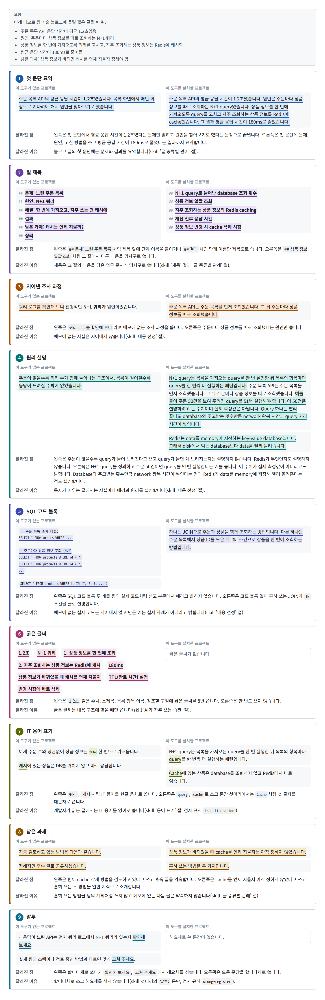
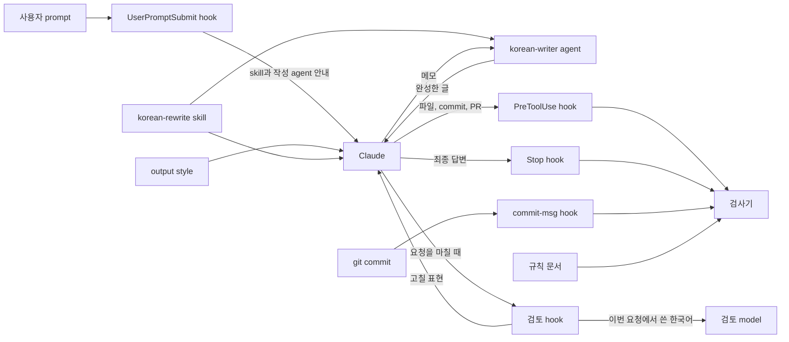

<h1 align="center">korean-rewrite</h1>

<p align="center">
  <strong>Claude Code용 한국어 글쓰기 skill과 hook 묶음입니다.</strong><br>
  Claude가 번역투 대신 자연스러운 한국어를 쓰게 합니다.
</p>

<p align="center">
  <a href="LICENSE"></a>
  <a href="https://github.com/nerdkim/korean-rewrite/actions/workflows/gate.yml"></a>
  
  
</p>

korean-rewrite는 Claude Code에서 Claude가 번역투 대신 자연스러운 한국어를 쓰게 하는 도구입니다. 설치하면 Claude는 답변을 포함한 모든 글을 업무 문서처럼 격식 있는 문어체로 씁니다. 구성 요소는 아래 표와 같습니다. 설치 script 하나가 이 구성 요소를 모두 프로젝트에 넣습니다.

| 종류 | 이름 | 하는 일 |
| --- | --- | --- |
| Skill | `korean-rewrite` | Claude가 session에서 처음 한국어를 쓰기 전에 부르는 작성 규칙입니다. 번역투의 정의, 고칠 표현과 고친 예, 말투, IT 용어 표기 규칙을 담았습니다. |
| Skill | `korean-style` | 검사 규칙을 확인하거나 어색한 표현의 원인을 찾을 때 부릅니다. |
| Subagent | `korean-writer` | 한글이 많은 글을 Claude 대신 씁니다. |
| Output style | `korean-style` | 답변의 말투와 기본 원칙을 정합니다. |
| Claude Code hook | `UserPromptSubmit`, `PreToolUse`, `Stop`, `SubagentStop` | Claude가 skill을 먼저 부르게 하고 Claude가 쓴 한국어를 검사기와 검토 model로 확인합니다. 설치 script가 이 네 시점에 실행되는 hook 5개를 등록합니다. Hook이 언제 무엇을 하는지는 [동작 원리](#동작-원리) 절에 있습니다. |
| Git hook | `commit-msg` | 어느 프로그램으로 commit하든 commit 메시지를 검사합니다. |
| 검사기 | `check-korean.mjs` | 규칙 문서 `.korean-style/rules.md`에 적힌 표현을 찾는 Node.js script입니다. Model과 network를 쓰지 않으므로 같은 글은 늘 같은 결과가 나옵니다. |

구성 요소마다 설치되는 경로는 [구조](#구조) 절에 있습니다.

## 특징

- **번역투를 쓰지 않게 합니다.** Skill에는 고칠 표현과 고친 예가 들어 있습니다. 예를 들어 `설정하는 것이 가능합니다`는 `설정할 수 있습니다`로 고칩니다. `요청에 대한 응답`처럼 사전에 오른 정상 용법은 그대로 둡니다.
- **답변도 업무 문서처럼 격식 있는 문어체로 쓰게 합니다.** 기본 말투는 합니다체이고 요청은 `~해 주십시오`로 끝냅니다. 설치할 때 해요체를 고를 수도 있습니다.
- **IT 용어는 영어 원어로 쓰게 합니다.** 개발자가 읽는 글에서는 `commit`, `deploy`, `server`처럼 쓰고 `커밋` 같은 음차와 `배포` 같은 번역어는 쓰지 않습니다. 이 표기는 업계에서 널리 따르는 관행이 아니라 이 도구가 정한 기본값입니다. 검사기의 IT 용어 규칙을 끄는 방법은 [설치와 사용](docs/usage.md)에 있습니다.
- **접속 부사를 앞뒤 관계에 맞게 고르게 합니다.** Skill은 원인과 결과를 `그래서`로, 근거와 결론을 `따라서`로 잇게 합니다.
- **메모에 없는 사실은 지어내지 않고 독자에게 필요한 설명은 채우게 합니다.** Skill은 머리말, 묻지 않은 제안, 요청에 없는 연도와 결정, 실제 코드처럼 보이는 예시 코드를 넣지 말라고 지시합니다. 블로그 글처럼 독자가 배우는 글에서는 메모에 나온 개념의 원리를 설명하게 합니다.
- **제목을 업무 문서식 명사구로 쓰게 합니다.** `## 다시 설치하기` 대신 `## 재설치`, `## 빠르게 시작하기` 대신 `## 설치 방법`처럼 씁니다. 검사기는 `-하기`, `-는 법`, `-는 것` 같은 꼴로 끝나는 Markdown 제목을 파일, commit 메시지, PR과 issue에 올리는 글에서 오류로 잡고 답변에서는 경고로 알립니다. 이 형식은 이 도구가 정한 기본값입니다. 규칙 문서에서 `heading-form-endings` 값을 비우면 검사하지 않습니다.
- **한글이 많은 글은 작성 agent가 씁니다.** Claude가 파일, commit 메시지, PR과 issue에 한글을 한 번에 200자 이상 쓰려고 하면 hook이 막고 `korean-writer` agent에게 맡기게 합니다. Claude는 독자, 글 종류, 말투, 담을 사실, 사실 사이의 관계를 적은 메모를 넘기고 이 agent가 쓴 글을 받아 씁니다. 작성 agent가 쓴 글이 Claude가 직접 쓴 글보다 나은지는 아직 측정하지 않았습니다.
- **검사기가 오류를 찾으면 hook이 막거나 다시 쓰게 합니다.** 검사기는 model이나 network를 쓰지 않으므로 같은 글의 검사 결과가 늘 같습니다.
- **요청을 마치면 검토 model이 글을 다시 읽습니다.** 검사기가 찾지 못하는 어색한 문장을 검토 model이 찾지만 모두 찾지는 못합니다.

## 설치 방법

Node.js 20 이상, npm, Git, Claude Code가 필요합니다. 명령은 macOS, Linux, WSL의 shell에서 실행합니다. 이 도구는 다른 npm package를 설치하지 않습니다. Claude Code의 plugin 명령(`/plugin install`)으로는 설치할 수 없습니다.

설치하는 방법은 Claude Code에게 맡기는 방법과 terminal에서 직접 명령을 실행하는 방법 두 가지입니다. 어느 방법으로 설치하든 설치한 뒤에 Claude Code를 재시작해야 합니다. 실행 중인 session을 끝내고 새 session을 열어야 skill과 hook이 적용됩니다.

### Claude Code를 이용한 설치

설치할 프로젝트의 root directory에서 Claude Code를 열고 아래 요청을 그대로 보내 주십시오.

```text
이 프로젝트에 korean-rewrite(https://github.com/nerdkim/korean-rewrite)를 설치해 주십시오. 프로젝트 root directory에서 `npx -y github:nerdkim/korean-rewrite --target . --activate`를 실행한 뒤 `node .korean-style/scripts/doctor.mjs`로 설치 상태를 확인해 주십시오.
```

Claude Code가 명령을 실행해도 되는지 물으면 허용해 주십시오. Claude가 두 명령을 실행하고 설치 결과와 점검 결과를 알려 줍니다. 그 뒤에 Claude Code를 재시작해 주십시오.

### 직접 설치

1. Terminal에서 설치할 프로젝트의 root directory로 이동합니다. 프로젝트 root directory에 `.git`이 없으면 설치 script는 `.gitignore` 항목을 추가하지 않고 `commit-msg` hook도 설치하지 않습니다. 새 프로젝트이면 먼저 `git init`을 실행합니다.
2. 다음 명령을 실행합니다.

   ```sh
   npx -y github:nerdkim/korean-rewrite --target . --activate
   node .korean-style/scripts/doctor.mjs
   ```

   첫 줄은 이 repository를 받아 설치 script를 실행합니다. 둘째 줄의 doctor는 설치 상태를 항목마다 점검하고 점검 결과의 마지막 줄에 `실패 0개, 주의 0개`처럼 개수를 출력합니다. 실패한 항목이 있으면 종료 코드 1로 끝납니다. 해결 방법은 [설치와 사용](docs/usage.md#문제-해결)에 있습니다.
3. Claude Code를 재시작합니다.

npx를 쓸 수 없으면 repository를 내려받아 설치 script를 직접 실행합니다.

```sh
git clone --depth 1 https://github.com/nerdkim/korean-rewrite.git /tmp/korean-rewrite
node /tmp/korean-rewrite/scripts/install.mjs --target "$PWD" --activate
```

처음 설치할 때 말투 option을 주지 않으면 Claude는 합니다체로 씁니다. 해요체로 쓰게 하려면 설치 명령 끝에 `--register 해요체`를 붙입니다.

`--activate`를 붙이면 프로젝트에서 이미 고른 output style도 `korean-style`로 바뀝니다. 이미 고른 output style을 그대로 두려면 `--activate`를 뺍니다. 다른 option은 [설치와 사용](docs/usage.md#설치-option)에 있습니다.

### 설치 확인

Claude Code를 재시작한 뒤 아래 [설치 전후 비교](#설치-전후-비교) 절의 요청을 그대로 보내 주십시오. Claude는 글을 쓰기 전에 `korean-rewrite` skill을 부릅니다. 받은 글은 그 절에 실은 두 답변과 비교해 볼 수 있습니다.

## 설치 전후 비교

아래 메모를 주고 팀 기술 블로그에 올릴 짧은 글을 써 달라고 Claude에게 요청했습니다. 요청은 이 도구가 없는 프로젝트와 이 도구를 설치한 프로젝트에서 각각 두 번 보냈습니다. 아래 이미지에서는 두 프로젝트에서 받은 첫 번째 답변을 비교합니다.

**요청**

<!-- korean-style-quote -->

> 아래 메모로 팀 기술 블로그에 올릴 짧은 글을 써 줘.  
>
> - 주문 목록 API 응답 시간이 평균 1.2초였음  
> - 원인: 주문마다 상품 정보를 따로 조회하는 N+1 쿼리  
> - 상품 정보를 한 번에 가져오도록 쿼리를 고치고, 자주 조회하는 상품 정보는 Redis에 캐시함  
> - 평균 응답 시간이 180ms로 줄어듦  
> - 남은 과제: 상품 정보가 바뀌면 캐시를 언제 지울지 정해야 함  

<!-- /korean-style-quote -->

요청은 Claude Opus 5.5(`claude-opus-5-5`)에 보냈고 Claude Code 2.1.310에서 effort를 medium으로 두었습니다. 이 도구가 없는 프로젝트의 답변은 2026년 11월 7일에, 이 도구를 설치한 프로젝트의 답변은 11월 8일(한국 시간)에 받았습니다. 요청을 보낼 때마다 새 session을 열었습니다. 두 프로젝트에서 모두 Claude가 쓸 수 있는 도구는 Skill, Read, Bash뿐이었습니다. 측정에 쓴 skill과 hook은 v0.7.0 tag에 든 것과 같습니다. 이 측정 뒤에 skill, 검사 규칙, 검토 model에게 주는 지시에 새 규칙을 추가했습니다. 나중으로 넘긴다는 뜻의 `미루다`를 `보류하다`나 `연기하다`로 고치게 하는 규칙입니다. 이 규칙을 추가한 뒤에는 측정을 다시 하지 않았습니다.



이미지의 카드마다 두 답변에서 달라진 곳 하나를 보여 줍니다. 카드에는 두 답변의 발췌, 달라진 점, 달라진 이유가 있습니다. `달라진 이유`에는 그 차이와 관련된 skill 절이나 검사 규칙을 적었습니다.

비교 항목과 설명은 생성형 AI가 두 프로젝트의 답변 네 개를 모두 읽고 정했습니다. 두 답변 사이에 차이가 있고 skill이나 검사 규칙이 다루는 곳만 골랐습니다. 같은 요청이어도 답변은 보낼 때마다 달라질 수 있습니다. 이미지에서는 프로젝트마다 첫 번째 답변 하나만 비교했습니다. 따라서 카드에 적은 skill 절이나 검사 규칙 때문에 답변이 달라졌다고 증명할 수는 없습니다.

생성형 AI는 다음 기준으로 판단했습니다. `메모에 없는 사실`(아래 목록의 3, 5, 8번 항목)은 메모에 적히지 않았는데 팀이 한 일처럼 쓴 조사 과정, 결정, 계획, 약속과 실제 코드처럼 보이게 넣은 코드입니다. `원리 설명`(4, 5, 8번 항목)은 N+1 query나 cache처럼 메모에 나온 개념을 일반 지식으로 풀어 쓴 내용이며 메모에 없는 사실로 보지 않습니다. `덧붙인 말`(목록 아래 문단)은 요청한 글 뒤에 요청한 사람에게 한 말입니다.

1. 첫 문단: 이 도구가 없는 프로젝트의 답변은 응답 시간이 1.2초였다는 문제만 밝히고 원인을 찾아보기로 했다는 문장으로 끝납니다. 설치한 프로젝트의 답변은 문제, 원인, 고친 방법, 결과(180ms)를 요약합니다.
2. 절 제목: 이 도구가 없는 프로젝트의 답변은 `## 문제: 느린 주문 목록`처럼 제목 앞에 단계 이름을 붙이거나 `## 결과`처럼 단계 이름만 제목으로 씁니다. 설치한 프로젝트의 답변은 `## 상품 정보 일괄 조회`, `## 상품 정보 변경 시 cache 삭제 시점`처럼 그 절에서 다룬 내용을 명사구로 씁니다.
3. 지어낸 조사 과정: 이 도구가 없는 프로젝트의 답변은 메모에 없는 `쿼리 로그를 확인해 보니`라는 조사 과정을 씁니다. 설치한 프로젝트의 답변은 원인만 씁니다.
4. 원리 설명: 이 도구가 없는 프로젝트의 답변은 query가 늘면 왜 느려지는지와 Redis가 무엇인지 설명하지 않습니다. 설치한 프로젝트의 답변은 N+1 query를 정의하고 주문 50건이면 query를 51번 실행한다는 예를 듭니다. 이 수치가 실제 측정값이 아니라고도 밝힙니다. Database와 주고받는 횟수만큼 network 왕복 시간이 쌓인다는 점과 Redis가 data를 memory에 저장해 빨리 돌려준다는 점도 설명합니다.
5. SQL 코드 블록: 이 도구가 없는 프로젝트의 답변은 SQL 코드 블록 두 개를 팀의 실제 코드처럼 싣고 본문에서 예라고 밝히지 않습니다. 설치한 프로젝트의 답변은 코드 블록 없이 흔히 쓰는 JOIN과 `IN` 조건을 글로 설명합니다.
6. 굵은 글씨: 이 도구가 없는 프로젝트의 답변은 굵은 글씨를 8번 쓰고 설치한 프로젝트의 답변은 쓰지 않습니다.
7. IT 용어 표기: 이 도구가 없는 프로젝트의 답변은 `쿼리`, `캐시`처럼 한글 음차로 쓰고 설치한 프로젝트의 답변은 `query`, `cache`로 씁니다.
8. 남은 과제: 이 도구가 없는 프로젝트의 답변은 팀이 cache 삭제 방법을 검토하고 있다고 쓰고 후속 글을 약속합니다. 설치한 프로젝트의 답변은 cache를 언제 지울지 아직 정하지 않았다고 쓰고 흔히 쓰는 두 방법을 일반 지식으로 소개합니다.
9. 말투: 이 도구가 없는 프로젝트의 답변은 `확인해 보세요`, `고쳐 주세요`에서 해요체를 섞습니다. 설치한 프로젝트의 답변은 모든 문장을 합니다체로 씁니다.

두 프로젝트의 첫 번째 답변에는 모두 글 끝의 가로줄 아래에 덧붙인 말이 있습니다. 이 도구가 없는 프로젝트의 덧붙인 말은 "메모에 없던 내용 몇 가지를 덧붙였습니다."로 시작하고 "실제 팀의 스택이나 검토 중인 방법과 다르면 맞게 고쳐 주세요."로 끝납니다. 이 도구를 설치한 프로젝트의 덧붙인 말은 "메모에 없는 내용을 몇 가지 덧붙였습니다."로 시작합니다. 이 덧붙인 말은 50건 예시, 일괄 조회 방법 두 가지, cache 삭제 방법 두 가지가 일반적인 설명이라고 밝히고 사실과 다르면 고쳐 달라고 합니다. 마지막 문장은 "실제로 JOIN과 `IN` 가운데 어느 방법을 썼는지 알려 주시면 그 부분을 실제 방식으로 바꿔 쓸 수 있습니다."라는 묻지 않은 제안입니다. 설치한 skill에는 글 끝에 묻지 않은 제안을 붙이지 말라는 지시가 있습니다. 이 답변은 그 지시를 따르지 않았습니다. 두 답변 모두 덧붙인 말이 있으므로 덧붙인 말은 이미지의 카드로 만들지 않았습니다.

두 프로젝트의 두 번째 답변에서도 위 목록의 첫 문단(1번), 굵은 글씨(6번), IT 용어 표기(7번), 남은 과제(8번), 말투(9번)의 차이가 다시 나타났습니다. 이 도구가 없는 프로젝트의 두 답변은 모두 cache를 지우는 방법을 팀이 지금 검토하는 방법이라고 쓰고 다음 글을 약속했습니다. 두 답변은 굵은 글씨를 각각 8번과 10번 썼고 글 뒤에 말을 덧붙였습니다. 덧붙인 말에서는 `맞게 고쳐 주세요`라고 해요체로 썼습니다.

이 도구가 없는 프로젝트의 두 번째 답변에는 지어낸 조사 과정(3번)과 SQL 코드 블록(5번)이 없었습니다. 이 답변은 목록이 길수록 DB 왕복 횟수가 늘어 응답 시간이 길어졌다고 설명했습니다. 설치한 프로젝트의 두 번째 답변도 query를 보낼 때마다 network 왕복 시간과 database 처리 시간이 든다고 설명했습니다. 이 답변은 Redis가 data를 memory에 저장한다고도 설명했습니다. 따라서 원리 설명(4번)에서는 Redis가 무엇인지 설명했는지만 달랐습니다.

이 도구를 설치한 프로젝트의 두 번째 답변에는 덧붙인 말, 굵은 글씨, SQL 코드 블록이 없었습니다. 이 답변은 첫 번째 답변과 달리 주문 50건 같은 구체적인 예를 들지 않고 주문이 N건이면 database에 query를 N+1번 보냈다고 설명했습니다. 남은 과제 절에서는 팀의 계획을 쓰지 않고 흔히 쓰는 cache 삭제 방법 두 가지를 소개했습니다.

절 제목(2번)의 차이도 두 번째 답변에서 다시 나타났습니다. 설치한 프로젝트의 두 번째 답변에는 `##` 제목이 네 개 있습니다. 다만 이 가운데 그 절에서 다룬 내용을 명사구로 쓴 제목은 `## N+1 query로 응답이 느려진 원인`, `## 상품 정보 일괄 조회`, `## 자주 조회하는 상품 정보의 Redis cache` 세 개뿐입니다. 나머지 하나인 `## 남은 과제: cache 삭제 시점`은 앞에 단계 이름을 붙인 제목입니다. 설치한 프로젝트의 첫 번째 답변은 같은 내용을 다룬 절의 제목을 `## 상품 정보 변경 시 cache 삭제 시점`으로 써서 단계 이름을 붙이지 않았습니다. Skill의 '글 종류별 관례' 절은 `## 해결 1: 예약 방식 변경`처럼 단계 이름을 앞에 붙인 제목을 고칠 예로 듭니다.

검사기와 평가 script가 집계한 값은 아래와 같습니다. 행 이름의 뜻은 [측정 결과 상세](#측정-결과-상세) 절에 있습니다. 프로젝트마다 처음 보낸 요청과 다시 보낸 요청에서 답변을 하나씩 받았습니다. 따라서 표의 두 비용 행에 적은 평균은 각각 그 답변 하나의 비용과 같습니다.

| 항목 | 이 도구가 없는 프로젝트 | 이 도구를 설치한 프로젝트 |
| --- | --- | --- |
| Skill을 거친 답변 | 2개 중 0개 | 2개 중 2개 |
| Stop hook이 다시 쓰게 한 답변 | 2개 중 0개 | 2개 중 0개 |
| 검사기가 오류를 찾은 답변 | 2개 중 2개 | 2개 중 0개 |
| 검사기가 해요체 어미를 찾은 답변 | 2개 중 2개 | 2개 중 0개 |
| 검사기가 IT 용어의 한글 음차를 찾은 답변 | 2개 중 2개 | 2개 중 0개 |
| 답변 길이 합계 | 2,900자 | 2,940자 |
| 처음 보낸 요청에서 답변 하나에 든 평균 비용 | $0.099 | $0.314 |
| 같은 요청을 다시 보냈을 때 답변 하나에 든 평균 비용 | $0.029 | $0.065 |
| 답변 하나를 받는 데 걸린 평균 시간 | 16.3초 | 34.0초 |

이 도구를 설치한 프로젝트는 비용과 시간이 더 들었습니다.

두 프로젝트의 첫 번째 답변 원문은 아래 접힌 블록에 글자 그대로 실었습니다.

<details>
<summary>이 도구가 없는 프로젝트의 첫 번째 답변 원문</summary>

<!-- korean-style-quote -->

> # 주문 목록 API 응답 시간을 1.2초에서 180ms로 줄인 이야기  
>
> ## 문제: 느린 주문 목록  
>
> 주문 목록 API의 평균 응답 시간이 **1.2초**였습니다. 목록 화면에서 매번 이 정도로 기다려야 해서 원인을 찾아보기로 했습니다.  
>
> ## 원인: N+1 쿼리  
>
> 쿼리 로그를 확인해 보니 전형적인 **N+1 쿼리**가 원인이었습니다. 주문 목록을 한 번 조회한 다음, 각 주문에 들어 있는 상품 정보를 주문마다 따로 조회하고 있었습니다.  
>
> ```sql
> -- 주문 목록 조회 (1번)
> SELECT * FROM orders WHERE ...;
>
> -- 주문마다 상품 정보 조회 (N번)
> SELECT * FROM products WHERE id = ?;
> SELECT * FROM products WHERE id = ?;
> ...
> ```
>
> 주문이 많을수록 쿼리 수가 함께 늘어나는 구조여서, 목록이 길어질수록 응답이 느려질 수밖에 없었습니다.  
>
> ## 해결: 한 번에 가져오고, 자주 쓰는 건 캐시에  
>
> 두 가지를 바꿨습니다.  
>
> **1. 상품 정보를 한 번에 조회**  
>
> 주문 목록에 필요한 상품 ID를 모아서 쿼리 한 번으로 가져오도록 고쳤습니다.  
>
> ```sql
> SELECT * FROM products WHERE id IN (?, ?, ?, ...);
> ```
>
> 이제 주문 수와 상관없이 상품 정보는 쿼리 한 번으로 가져옵니다.  
>
> **2. 자주 조회하는 상품 정보는 Redis에 캐시**  
>
> 여러 주문에 반복해서 나오는 상품이 많다는 점을 활용해, 자주 조회하는 상품 정보는 Redis에 캐시했습니다. 캐시에 있는 상품은 DB를 거치지 않고 바로 응답합니다.  
>
> ## 결과  
>
> | 항목 | 개선 전 | 개선 후 |  
> |---|---|---|  
> | 평균 응답 시간 | 1.2초 | **180ms** |  
>
> 평균 응답 시간이 약 85% 줄었습니다.  
>
> ## 남은 과제: 캐시는 언제 지울까?  
>
> 캐시를 쓰면 바로 따라오는 문제가 있습니다. **상품 정보가 바뀌었을 때 캐시를 언제 지울지**입니다. 가격이나 상품명이 바뀌었는데 캐시에 예전 정보가 남아 있으면 사용자에게 잘못된 정보가 보입니다.  
>
> 지금 검토하고 있는 방법은 다음과 같습니다.  
>
> - **TTL(만료 시간) 설정**: 일정 시간이 지나면 캐시가 자동으로 사라지게 합니다. 단순하지만 만료 전까지는 예전 정보가 보일 수 있습니다.  
> - **변경 시점에 바로 삭제**: 상품 정보를 수정할 때 해당 캐시를 함께 지웁니다. 정확하지만 상품을 수정하는 모든 경로에서 빠짐없이 처리해야 합니다.  
>
> 어떤 방식이 맞을지는 상품 정보가 얼마나 자주 바뀌는지, 예전 정보가 잠깐 보여도 괜찮은지에 따라 달라집니다. 정해지면 후속 글로 공유하겠습니다.  
>
> ## 정리  
>
> - 응답이 느린 API는 먼저 쿼리 로그에서 N+1 쿼리가 있는지 확인해 보세요.  
> - 반복되는 개별 조회는 `IN` 쿼리 한 번으로 묶을 수 있습니다.  
> - 캐시를 도입할 때는 캐시를 언제 지울지도 함께 정해야 합니다.  
>
> ---  
>
> 메모에 없던 내용 몇 가지를 덧붙였습니다. SQL 예시는 설명을 위해 일반적인 형태로 썼고, "약 85% 감소"는 1.2초와 180ms로 계산한 값입니다. 캐시 삭제 방식 두 가지는 흔히 쓰는 방법을 예로 든 것입니다. 실제 팀의 스택이나 검토 중인 방법과 다르면 맞게 고쳐 주세요.  

<!-- /korean-style-quote -->

</details>

<details>
<summary>이 도구를 설치한 프로젝트의 첫 번째 답변 원문</summary>

<!-- korean-style-quote -->

> # 주문 목록 API 응답 시간 1.2초에서 180ms로 단축  
>
> 주문 목록 API의 평균 응답 시간이 1.2초였습니다. 원인은 주문마다 상품 정보를 따로 조회하는 N+1 query였습니다. 상품 정보를 한 번에 가져오도록 query를 고치고 자주 조회하는 상품 정보를 Redis에 cache했습니다. 그 결과 평균 응답 시간이 180ms로 줄었습니다.  
>
> ## N+1 query로 늘어난 database 조회 횟수  
>
> N+1 query는 목록을 가져오는 query를 한 번 실행한 뒤 목록의 항목마다 query를 한 번씩 더 실행하는 패턴입니다. 주문 목록 API는 주문 목록을 먼저 조회했습니다. 그 뒤 주문마다 상품 정보를 따로 조회했습니다. 예를 들어 주문 50건을 보여 주려면 query를 51번 실행해야 합니다. 이 50건은 설명하려고 든 수치이며 실제 측정값은 아닙니다. Query 하나는 빨리 끝나도 database와 주고받는 횟수만큼 network 왕복 시간과 query 처리 시간이 쌓입니다. 그래서 주문이 많을수록 응답이 느려집니다.  
>
> ## 상품 정보 일괄 조회  
>
> 상품 정보를 한 번에 가져오도록 query를 고쳤습니다. 이런 문제에는 보통 두 가지 방법을 씁니다. 하나는 JOIN으로 주문과 상품을 함께 조회하는 방법입니다. 다른 하나는 주문 목록에서 상품 ID를 모은 뒤 `IN` 조건으로 상품을 한 번에 조회하는 방법입니다. 어느 방법을 쓰든 상품 정보를 조회하는 횟수가 주문 수와 상관없이 일정해집니다.  
>
> ## 자주 조회하는 상품 정보의 Redis caching  
>
> Redis는 data를 memory에 저장하는 key-value database입니다. 그래서 disk에서 읽는 database보다 data를 빨리 돌려줍니다. 자주 조회하는 상품 정보를 Redis에 cache했습니다. Cache에 있는 상품은 database를 조회하지 않고 Redis에서 바로 읽습니다.  
>
> ## 개선 전후 응답 시간  
>
> | 구분 | 평균 응답 시간 |  
> | --- | --- |  
> | 개선 전 | 1.2초 (1,200ms) |  
> | 개선 후 | 180ms |  
>
> 평균 응답 시간이 1,020ms 줄었습니다. 개선 전보다 약 85% 짧아졌습니다.  
>
> ## 상품 정보 변경 시 cache 삭제 시점  
>
> 상품 정보가 바뀌었을 때 cache를 언제 지울지는 아직 정하지 않았습니다. Cache를 지우지 않으면 상품 정보가 바뀐 뒤에도 주문 목록에 예전 정보가 나올 수 있습니다.  
>
> 흔히 쓰는 방법은 두 가지입니다. 첫째, cache에 만료 시간(TTL)을 정해 두면 시간이 지난 cache가 저절로 지워집니다. 이 방법은 구현이 간단합니다. 그러나 만료되기 전까지는 예전 정보가 나올 수 있습니다. 둘째, 상품 정보를 수정할 때 해당 상품의 cache를 함께 지우는 방법이 있습니다. 이 방법을 쓰면 바뀐 정보가 바로 반영됩니다. 다만 상품 정보를 수정하는 코드에서 cache를 빠짐없이 지워야 합니다. 이 과제에 어떤 방법이 맞는지는 아직 정하지 않았습니다.  
>
> ---  
>
> 메모에 없는 내용을 몇 가지 덧붙였습니다. 50건 예시와 일괄 조회 방법 두 가지, cache 삭제 방법 두 가지는 독자의 이해를 돕는 일반적인 설명입니다. 팀이 실제로 고른 방법이 아니므로 사실과 다르면 고쳐 주십시오. 실제로 JOIN과 `IN` 가운데 어느 방법을 썼는지 알려 주시면 그 부분을 실제 방식으로 바꿔 쓸 수 있습니다.  

<!-- /korean-style-quote -->

</details>

요청 원문은 [readme.json](test/fixtures/eval/readme.json)에 있습니다. 위 이미지는 `npm run compare`로 만들었습니다. 평가를 다시 실행하는 명령과 이미지를 만든 명령은 [재실행 방법](docs/examples.md#재실행-방법)에 있습니다.

평가를 직접 실행한 뒤 결과를 저장한 경로를 넘겨 `npm run eval -- --summary`를 실행하면 위 표와 같은 항목을 집계할 수 있습니다. 평가를 다시 실행하면 답변이 달라지므로 숫자도 위 표와 다를 수 있습니다.

위 비교에는 설치한 프로젝트의 답변 가운데 지금의 skill로 받은 두 답변만 썼습니다. 다만 이 요청은 skill을 지금 모습으로 고치는 동안 그 효과를 확인하는 데에도 썼습니다. Skill을 고칠 때마다 이 요청을 다시 보냈으므로 skill이 이 요청에 맞춰 고쳐졌을 수 있습니다. 또한 이 비교는 요청 하나로 본 결과입니다. 따라서 다른 글에서도 같은 차이가 난다고 말할 수 없습니다. 요청 열두 가지로 측정한 결과는 [측정 결과 상세](#측정-결과-상세) 절에 있습니다.

## 사용 방법

설치하고 Claude Code를 재시작하면 따로 할 일은 없습니다. Skill을 직접 부르려면 메시지 맨 앞에 `/`와 skill 이름을 입력합니다.

| Skill | 쓸 때 | 예 |
| --- | --- | --- |
| `korean-rewrite` | 한국어 글을 쓰거나 다듬을 때, 영어 문서를 한국어로 옮길 때 | `/korean-rewrite docs/guide.md를 자연스러운 한국어로 다듬어 주십시오` |
| `korean-style` | 검사 규칙을 확인하거나 표현이 어색한 이유를 찾을 때 | `/korean-style README.md에서 어색한 표현을 찾아 주십시오` |

검사기는 Claude 없이 직접 실행할 수 있습니다. 검사기는 파일을 고치지 않고 찾은 표현을 오류와 경고로 나눠 보여 줍니다. 오류는 hook이 막거나 다시 쓰게 하는 표현이고 경고는 hook이 알리기만 하는 표현입니다. 오류가 있으면 종료 코드 1로, 경고만 있으면 0으로 끝납니다.

```sh
node .korean-style/scripts/check-korean.mjs --file docs/guide.md
node .korean-style/scripts/check-korean.mjs --all
node .korean-style/scripts/check-korean.mjs --explain translationese
```

- **규칙 변경.** 규칙 문서 `.korean-style/rules.md` 안의 `korean-style-rules` 코드 블록을 고치면 Claude Code를 재시작하지 않아도 바로 적용됩니다. 직접 고친 규칙 문서는 재설치해도 그대로 남습니다.
- **IT 용어 검사 비활성화.** 규칙 문서에서 `banned-transliteration`, `ambiguous-transliteration`, `banned-translation` 세 키의 값을 비웁니다. 자세한 방법은 [규칙 변경](docs/usage.md#규칙-변경)에 있습니다.
- **검토 hook 비활성화와 검토 model 변경.** `reviewer-model:`의 값을 비우면 검토 hook이 꺼집니다. 기본값은 `sonnet`이고 `opus`나 `haiku`를 적어 변경할 수 있습니다.
- **작성 agent에게 답변 위임.** 규칙 문서의 기본값으로는 Claude가 화면에 나오는 답변을 작성 agent에게 맡기지 않습니다. 맡기려면 `writer-agent-answer-min-hangul`의 값을 0보다 크게 정합니다. 그러면 Claude는 한글이 그 수 이상인 답변마다 작성 agent에게 메모를 넘기고 돌려받은 글을 다시 출력합니다. 그래서 답변이 늦어집니다.
- **Codex와 Gemini CLI.** 두 프로그램에서는 skill, output style, Claude Code hook이 동작하지 않습니다. Git `commit-msg` hook은 어느 프로그램으로 commit하든 commit 메시지를 검사합니다. 같은 기준을 따르게 하는 방법은 [다른 코딩 agent](docs/usage.md#다른-코딩-agent)에 있습니다.

자세한 내용은 [설치와 사용](docs/usage.md)과 [검사 규칙](docs/rules.md)에 있습니다.

## 설치 후 시스템 영향

설치 script는 구성 요소를 프로젝트의 `.claude/`와 `.korean-style/` directory에 복사합니다. 프로젝트마다 설치하며 사용자 전역 설정 directory(`~/.claude/`)에는 설치하지 않습니다. 설치 script가 프로젝트에서 바꾸는 내용은 다음과 같습니다.

- `.claude/settings.json`에 Claude Code hook 다섯 개를 등록합니다.
- `.claude/agents/korean-writer.md`에 작성 agent를 만듭니다.
- 프로젝트에서 고른 output style이 없으면 `korean-style`을 고릅니다. `--activate`를 붙이면 이미 고른 output style도 `korean-style`로 바꿉니다.
- `attribution`의 `commit`과 `pr`에 값이 없으면 빈 값을 넣습니다. 그러면 Claude Code가 commit 메시지와 PR 설명에 `Co-Authored-By: Claude` 줄 같은 생성 표시를 붙이지 않습니다.
- `env`에 `CLAUDE_CODE_THINKING_DISPLAY_UPDATES` 값이 없으면 `0`을 넣습니다. 진행 보고는 Claude가 도구를 부르는 사이에 쓰는 글입니다. Server가 이 진행 보고를 요약해 보낸 문장은 skill과 검사기를 거치지 않습니다. `0`을 넣으면 이 문장이 화면에 나오지 않습니다. 자세한 내용은 [Server가 요약한 진행 보고](docs/how-it-works.md#server가-요약한-진행-보고)에 있습니다.
- Git repository에서는 Git의 hook directory(기본값 `.git/hooks/`)에 `commit-msg` hook을 설치합니다.

설치 script는 `attribution`과 `env`에서 프로젝트가 이미 정해 둔 값을 바꾸지 않습니다.

## 재설치

같은 설치 명령을 다시 실행하면 skill, output style, 작성 agent, 검사기, hook script가 최신 버전으로 바뀝니다.

설치 script는 규칙 문서를 이와 다르게 처리합니다. 규칙 문서를 고치지 않았으면 새 기본 규칙이 적용됩니다. 직접 고친 규칙 문서와 고쳤는지 확인할 수 없는 예전 규칙 문서는 그대로 둡니다. 그대로 둔 규칙 문서에는 새 기본 규칙에서 추가한 키와 값이 들어가지 않습니다.

새 기본 규칙으로 바꾸려면 설치 명령에 `--force`를 붙입니다. 이때 설치 script가 원래 규칙을 `.korean-style/rules.backup-*.md`에 backup하므로 필요한 내용을 옮겨 올 수 있습니다.

0.4.1까지의 기본 규칙은 IT 용어의 한글 음차를 검사하지 않았습니다. 그래서 0.4.1까지의 버전으로 설치한 규칙 문서가 재설치한 뒤에도 그대로 남으면 검사기는 한글 음차를 계속 검사하지 않습니다. 새 기본 규칙에서는 개발자가 읽는 글에 쓴 한글 음차를 검사기가 오류로 잡습니다.

팀에서 함께 쓰는 방법은 [재설치와 팀 공유](docs/usage.md#재설치와-팀-공유)에, 제거 방법은 [제거](docs/usage.md#제거)에 있습니다.

## 측정 결과 상세

요청 열두 가지를 Claude Opus 5.5(`claude-opus-5-5`)에 보냈습니다. 요청은 질문 3가지, 글 작성 7가지, 번역과 교정 2가지입니다. 요청마다 이 도구를 설치한 프로젝트에서 두 번, 설치하지 않은 프로젝트에서 두 번 보냈습니다. 그래서 프로젝트마다 답변 24개를 받았습니다. 요청을 보낼 때마다 새 session을 열었습니다.

측정은 2026년 11월 6일(한국 시간)에 Claude Code 2.1.310에서 effort를 medium으로 두고 실행했습니다. 두 프로젝트에서 Claude가 쓸 수 있는 도구는 Skill, Read, Bash뿐이었습니다.

이 측정에서는 0.4.1을 release한 뒤 개편한 skill, output style, 검사 규칙을 설치했습니다. 이 개편은 0.5.0에 들어갔습니다. 측정한 뒤에도 skill과 output style을 고쳤으므로 설치한 내용은 지금 버전과 같지 않습니다. 측정 뒤에 고친 예는 [설치 전후 예시](docs/examples.md)의 앞부분에 있습니다.

작성 agent와 검토 hook도 설치되어 있었지만 이 측정의 답변에는 영향을 주지 않았습니다. Claude가 Agent 도구를 쓸 수 없었으므로 작성 agent는 쓰이지 않았습니다. 검토 hook은 답변에 대한 지적을 같은 session의 다음 요청에서 알립니다. 이 측정에서는 요청마다 새 session을 열었으므로 검토 hook의 지적이 Claude에게 전해지지 않았습니다.

이 절의 첫 번째 표에 나오는 행 이름 가운데 세 가지의 뜻은 다음과 같습니다.

- `Skill을 거친 답변`은 Claude가 답변을 쓰기 전에 `korean-rewrite` skill을 부른 답변입니다.
- `Stop hook이 다시 쓰게 한 답변`은 답변을 마칠 때 실행되는 Stop hook이 검사기 오류를 찾아 한 번 다시 쓰게 한 답변입니다.
- `해요체로만 쓴 답변`은 검사기가 해요체 어미를 찾은 답변 가운데 합니다체로 끝난 문장이 하나도 없는 답변입니다.

검사기는 답변에서 찾은 표현을 오류와 경고로 나눕니다. Hook은 오류만 막거나 다시 쓰게 하고 경고는 알리기만 합니다. 답변에서는 IT 용어의 한글 음차와 번역어를 경고로만 알립니다.

검사기는 규칙 문서에 정한 말투와 다른 종결 어미를 오류로 잡습니다. 이 측정에서는 두 프로젝트의 답변을 모두 말투를 합니다체로 정한 규칙 문서로 검사했습니다. 그래서 해요체로만 쓴 답변도 검사기가 오류를 찾은 답변으로 집계됐습니다.

비용은 요청을 처음 보냈을 때와 다시 보냈을 때로 나눠 적었습니다. 같은 요청을 다시 보내면 API가 처음 요청 때 cache에 저장한 입력을 다시 읽으므로 비용이 줄어듭니다.

| 항목 | 이 도구가 없는 프로젝트 | 이 도구를 설치한 프로젝트 |
| --- | --- | --- |
| Skill을 거친 답변 | 24개 중 0개 | 24개 중 24개 |
| Stop hook이 다시 쓰게 한 답변 | 24개 중 0개 | 24개 중 1개 |
| 검사기가 오류를 찾은 답변 | 24개 중 17개 | 24개 중 0개 |
| 검사기가 해요체 어미를 찾은 답변 | 24개 중 16개 | 24개 중 0개 |
| 해요체로만 쓴 답변 | 24개 중 3개 | 24개 중 0개 |
| 검사기가 IT 용어의 한글 음차를 찾은 답변 | 24개 중 18개 | 24개 중 4개 |
| 검사기가 IT 용어의 번역어를 찾은 답변 | 24개 중 6개 | 24개 중 0개 |
| Emoji가 들어간 답변 | 24개 중 5개 | 24개 중 0개 |
| 가운뎃점이 들어간 답변 | 24개 중 3개 | 24개 중 0개 |
| Claude Code 생성 표시가 들어간 답변 | 24개 중 2개 | 24개 중 0개 |
| 답변 길이 합계 | 20,242자 | 12,178자 |
| 처음 보낸 요청에서 답변 하나에 든 평균 비용 | $0.045 | $0.215 |
| 같은 요청을 다시 보냈을 때 답변 하나에 든 평균 비용 | $0.018 | $0.158 |
| 답변 하나를 받는 데 걸린 평균 시간 | 10.6초 | 12.9초 |

이 도구가 없는 프로젝트에서 검사기가 오류를 찾은 답변 17개 가운데 16개에서는 해요체 어미가 오류로 잡혔습니다. 이 16개 가운데 13개는 한 답변 안에서 합니다체와 해요체를 섞었고 3개는 해요체로만 썼습니다. 말투를 섞은 13개는 어느 말투를 정했든 고쳐야 할 글입니다.

해요체 어미가 잡힌 16개 가운데 8개에서는 다른 오류도 함께 나왔습니다. 위 표에서 emoji, 가운뎃점, Claude Code 생성 표시가 들어간 답변은 모두 이 8개에 듭니다. 검사기는 이 8개 가운데 2개에서 `타깃`을 `타겟`으로 적은 표기도 `loanword-spelling` 오류로 잡았습니다. 해요체 어미가 잡히지 않은 나머지 1개는 en dash(U+2013)를 써서 오류로 집계됐습니다. 따라서 말투를 고쳐도 17개 가운데 9개에는 오류가 남습니다. 해요체로만 쓴 3개 가운데 2개도 이 8개에 듭니다. 말투 오류만 있는 나머지 1개는 말투를 합니다체로 정한 규칙 문서로 검사했기 때문에 검사기가 오류를 찾은 답변으로 집계됐습니다.

이 도구를 설치한 프로젝트에서 IT 용어의 한글 음차를 찾은 답변 4개 가운데 2개는 사용자가 준 문단을 다듬는 요청의 답변입니다. 이 두 답변은 원문의 `라이브러리`, `캐시`, `옵션`, `서버`, `데이터`를 한글 그대로 두었습니다. 사용자가 준 글의 표기를 바꾸지 않는다는 skill 규칙에 맞는 처리입니다. 나머지 2개는 Chrome 확장 프로그램 질문의 답변에서 `폴더`를, Kubernetes 질문의 답변에서 `스케줄러`를 한글로 쓴 경우입니다.

Stop hook이 다시 쓰게 한 답변 1개는 `확인하십시오`처럼 사람에게 명령하는 어미를 쓴 답변이었습니다. Claude는 이 어미를 `확인해 주십시오`처럼 요청하는 어미로 고쳐 답변을 다시 썼습니다.

이 도구를 설치한 프로젝트는 비용과 시간이 더 들었습니다.

검사기가 집계할 수 없는 세 항목은 생성형 AI가 두 프로젝트의 답변 48개를 모두 읽고 집계했습니다. 세 항목의 뜻은 다음과 같습니다.

- 머리말은 요청한 글 앞에 붙여 답변 자체를 소개하거나 이어질 순서를 알리는 문장입니다.
- 덧붙인 말은 요청한 글 뒤에 붙인 제안, 질문, 설명입니다.
- 요청에 없는 내용은 연도, 요일, 원인, test 목록, 예시 코드, 명령 출력처럼 사용자가 주지 않았는데 답변에 넣은 사실, 목록, 코드입니다.

판단 기준의 자세한 내용은 [설치 전후 예시](docs/examples.md)의 `Skill 예문과 겹치는 요청` 절에 있습니다.

| 항목 | 이 도구가 없는 프로젝트 | 이 도구를 설치한 프로젝트 |
| --- | --- | --- |
| 머리말이 있는 답변 | 24개 중 7개 | 24개 중 5개 |
| 덧붙인 말이 있는 답변 | 24개 중 17개 | 24개 중 6개 |
| 요청에 없는 내용이 있는 답변 | 24개 중 15개 | 24개 중 2개 |

이 도구를 설치한 프로젝트에서 덧붙인 말이 있는 답변 6개 가운데 4개는 요청에 없어서 본문에 넣지 않은 내용이 무엇인지 설명했습니다. Skill은 이런 설명을 덧붙이지 말라고 합니다.

요청 열두 가지 가운데 다섯 가지는 요청 원문이나 요청한 글의 구절이 skill 예문에 그대로 나옵니다. 이런 요청에서는 Claude가 skill 예문을 따라 썼을 수 있습니다. 그래서 나머지 일곱 가지 요청의 답변만 따로 집계했습니다.

| Skill 예문과 겹치지 않는 요청 일곱 가지 | 이 도구가 없는 프로젝트 | 이 도구를 설치한 프로젝트 |
| --- | --- | --- |
| 머리말이 있는 답변 | 14개 중 4개 | 14개 중 4개 |
| 덧붙인 말이 있는 답변 | 14개 중 12개 | 14개 중 5개 |
| 요청에 없는 내용이 있는 답변 | 14개 중 11개 | 14개 중 2개 |

겹치지 않는 요청에서도 덧붙인 말과 요청에 없는 내용은 이 도구를 설치한 프로젝트의 답변에 더 적게 나왔습니다. 머리말은 두 프로젝트 모두 14개 중 4개로 차이가 없었습니다.

평가를 직접 실행한 뒤 결과를 저장한 경로를 넘겨 `npm run eval -- --summary`를 실행하면 이 절의 첫 번째 표와 같은 항목을 집계할 수 있습니다. 실행 명령은 [재실행 방법](docs/examples.md#재실행-방법)에 있습니다. 평가를 다시 실행하면 답변이 달라지므로 숫자도 달라질 수 있습니다.

요청 열두 가지와 요청마다 두 프로젝트에서 받은 첫 번째 답변은 [설치 전후 예시](docs/examples.md)에 있습니다.

## 동작 원리

이 도구는 Claude가 한국어를 쓰기 전에 기준을 주고 쓴 뒤에 글을 검사합니다.



**작성 전.** Claude는 session에서 처음 한국어를 쓰기 전에 `korean-rewrite` skill을 한 번 부릅니다. 사용자가 prompt를 보낼 때마다 UserPromptSubmit hook은 Claude가 이 session에서 skill을 불렀는지 확인합니다. 아직 부르지 않았으면 한국어를 쓰기 전에 skill을 부르라고 안내하고, 이미 불렀으면 다시 부르지 말고 skill에 적힌 절차를 따르라고 안내합니다.

**작성 후.** Claude가 파일에 쓰거나 `git commit`, `gh pr`, `gh issue`를 실행하기 직전에 PreToolUse hook이 글을 검사하고 오류가 있으면 막습니다. Claude가 답변을 마치면 Stop hook이 답변을 검사해 오류가 있으면 한 번 다시 쓰게 합니다.

**요청 처리 후.** Claude가 요청을 마치면 검토 hook이 그 요청에서 Claude가 쓴 한국어를 검토 model에게 보냅니다. 검토 hook은 background에서 실행되므로 답변이 늦어지지 않습니다. 파일, commit 메시지, PR과 issue 글에 대한 지적은 Claude Code가 Claude에게 전달합니다. 답변에 대한 지적은 다음 요청 때 hook이 Claude에게 알립니다.

자세한 내용은 [동작 원리](docs/how-it-works.md)에 있습니다.

## 구조

설치 script는 이 repository의 파일을 프로젝트에 복사하고 프로젝트 설정에 hook을 등록합니다.

| 구성 요소 | 내용 | 이 repository의 경로 | 설치한 프로젝트의 경로 |
| --- | --- | --- | --- |
| `korean-rewrite` skill | 한국어 작성 순서와 고칠 표현 | `skill/korean-rewrite/` | `.claude/skills/korean-rewrite/` |
| `korean-style` skill | 검사 규칙을 확인하고 어색한 표현의 원인을 찾는 방법 | `skill/korean-style/` | `.claude/skills/korean-style/` |
| Output style | 말투와 기본 원칙 | `output-styles/korean-style.md` | `.claude/output-styles/korean-style.md` |
| `korean-writer` agent | 메모를 받아 한국어 글을 쓰는 agent | `agents/korean-writer.md` | `.claude/agents/korean-writer.md` |
| 규칙 문서 | 검사할 표현과 규칙마다 정한 등급 | `docs/rules.md` | `.korean-style/rules.md` |
| 검사기 | 규칙 문서대로 글을 검사하는 프로그램 | `scripts/check-korean.mjs`, `scripts/lib/` | `.korean-style/scripts/` |
| Claude Code hook | Prompt를 보낼 때 안내하고 도구 실행 직전과 답변을 마칠 때 검사하는 script | `scripts/hooks/` | `.korean-style/scripts/hooks/`, `.claude/settings.json` |
| 검토 hook | 요청을 마친 뒤 Claude가 그 요청에서 쓴 한국어를 검토 model에게 보내 다시 읽게 하는 script | `scripts/hooks/review.mjs`, `scripts/lib/review.mjs` | `.korean-style/scripts/hooks/review.mjs`, `.claude/settings.json` |
| Git hook | Commit 메시지를 검사하는 script | `scripts/hooks/commit-msg.mjs` | `.korean-style/scripts/hooks/commit-msg.mjs`, `.git/hooks/commit-msg` |
| `doctor` | 설치 상태를 확인하는 script | `scripts/doctor.mjs` | `.korean-style/scripts/doctor.mjs` |

규칙 문서와 프로젝트 설정처럼 팀이 함께 쓸 파일은 repository에 commit합니다. 설치 script는 검사기, hook script, skill, output style, 작성 agent의 경로를 `.gitignore`에 넣습니다. 그래서 이 파일들은 commit되지 않습니다. 따라서 repository를 clone한 팀원도 설치 명령을 한 번 실행해야 합니다.

규칙 module 목록은 [규칙 module](docs/how-it-works.md#규칙-module)에 있습니다.

## 제약

- Hook은 Claude가 skill을 불렀는지만 확인하고 skill에 적힌 순서를 모두 따랐는지는 확인하지 않습니다.
- 검사기는 규칙 문서에 적힌 형태만 찾으므로 요청에 없는 내용과 공개하면 안 되는 정보는 잡지 못합니다.
- 검사기는 답변이 개발자에게 하는 말인지 이용자 공지 초안인지 가려내지 못하므로 답변에서는 IT 용어의 한글 음차를 경고로만 알립니다.
- Stop hook은 답변이 화면에 나온 뒤에 실행되므로 다시 쓰기 전의 답변도 화면에 남습니다. 다시 쓴 답변은 Stop hook이 다시 검사하지 않습니다.
- 검토 model도 번역투를 모두 찾지는 못합니다.
- 검토 hook은 `claude` 명령으로 검토 model을 부르므로 PATH에 `claude` 명령이 있어야 합니다. 검토 model을 부를 때마다 Claude Code 계정 사용량도 늘어납니다.
- 이 도구는 기술 설명이 맞는지 확인하지 않습니다. 요청 열두 가지로 측정할 때도 이 도구를 설치한 프로젝트의 답변에 틀린 기술 설명이 있었습니다.

나머지 제약은 [제약](docs/limits.md)에 있습니다.

## 문서

| 문서 | 내용 |
| --- | --- |
| [설치와 사용](docs/usage.md) | 설치 option, 설치되는 파일, 사용 방법, 규칙 변경, 재설치와 팀 공유, 제거, 문제 해결 |
| [동작 원리](docs/how-it-works.md) | Hook이 언제 무엇을 검사하고 막는지, 검사기가 글을 처리하는 순서 |
| [검사 규칙](docs/rules.md) | 규칙 목록과 규칙을 오류와 경고로 나눈 근거 |
| [한국어 작성 원칙](docs/writing.md) | Skill이 따르는 원칙과 출처 |
| [제약](docs/limits.md) | 이 도구로 할 수 없는 일 |
| [설치 전후 예시](docs/examples.md) | 요청 열두 가지마다 두 프로젝트에서 받은 답변과 그 차이 |

## 기여 방법

- Bug와 제안은 [Issues](https://github.com/nerdkim/korean-rewrite/issues)에 남겨 주십시오. Pull request를 환영합니다.
- 작업 지침은 `CLAUDE.md`에 있습니다. `AGENTS.md`와 `GEMINI.md`는 이 파일을 가리키는 symlink입니다.
- 이 repository를 Claude Code로 열면 `.claude/settings.json`에 등록한 hook이 `scripts/hooks/`의 script를 바로 실행하므로 고친 hook과 규칙을 그 자리에서 써 볼 수 있습니다.
- 동작을 바꾸면 `test/`에 회귀 test를 추가하고, 검사기가 잡으면 안 되는 문장도 넣습니다.
- 검사 규칙과 등급(오류나 경고)은 `docs/rules.md`에서 정하고 코드에 정책 값을 숨기지 않습니다. 작성 규칙은 `skill/korean-rewrite/SKILL.md`에, 근거와 출처는 `docs/writing.md`에 있습니다.
- Commit하기 전에 `npm run gate`를 실행합니다. GitHub Actions는 push와 pull request마다 Node.js 20, 22, 24, 26에서 `npm run gate`를 실행합니다. `package.json`에 dependency가 있으면 이 workflow가 실패합니다.
- 실제 model로 하는 평가는 유료 API를 쓰므로 일반 test에 넣지 않고 `npm run eval -- --run`으로 따로 실행합니다. 평가 결과는 `.eval/`에만 두고 Git에 넣지 않습니다.
- README에서 두 답변을 비교하는 이미지는 `npm run compare`로 만듭니다. 이 명령에는 `--request`로 평가 입력 파일을, `--left`와 `--right`로 두 프로젝트의 `results.json` 경로를 넘깁니다. 비교 항목과 설명은 `docs/images/readme-compare.json`에 있습니다.

## 라이선스

[MIT](LICENSE)
