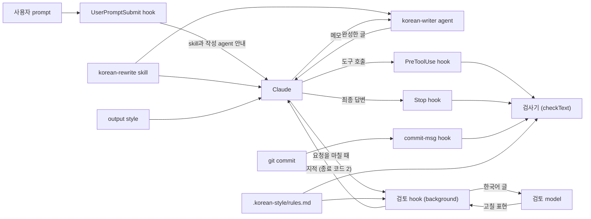

# 동작 원리

README와 [설치와 사용](usage.md)에서 다루지 않는 내부 동작을 설명합니다.

Claude는 session에서 처음 한국어를 쓰기 전에 `korean-rewrite` skill을 한 번 부릅니다. Skill에는 처음부터 한국어로 생각하는 원칙과 작성 순서가 들어 있습니다. Claude가 쓴 글은 검사기가 프로젝트 규칙과 대조합니다. Hook은 skill을 부르기 전에 쓴 글과 검사기가 오류를 찾은 글을 파일, commit, PR에 쓰지 못하게 막습니다. 이런 글이 답변이면 한 번 다시 쓰게 합니다. 기존 파일을 고칠 때는 이번 편집으로 새로 생긴 오류만 막습니다. Claude가 요청을 마치면 검토 hook이 그 요청에서 쓴 한국어를 검토 model에게 따로 보내 다시 읽게 합니다.
검사기는 Node.js 프로그램이고 규칙 문서에 적힌 목록과 한도에 따라 글을 검사합니다. Model을 호출하거나 network에 접속하지 않으므로 같은 글을 같은 규칙으로 검사하면 결과도 항상 동일합니다.



## Skill을 건너뛰지 못하게 하는 방식

사용자가 prompt를 보낼 때마다 UserPromptSubmit hook(`userprompt.mjs`)이 그 prompt에 안내를 덧붙여 Claude에게 전합니다. 이 session에서 skill을 아직 부르지 않았으면 한국어를 쓰기 전에 Skill 도구로 `korean-rewrite` skill을 부르라고 안내합니다. 이미 불렀으면 Skill 도구로 다시 부르지 말고 skill에 적힌 절차를 따르라고 안내합니다. 어느 쪽이든 구상할 때부터 한국어로 생각하라는 안내도 붙입니다.

이 문서에서 요청 하나는 사용자가 prompt를 보낸 뒤 Claude가 답을 마칠 때까지를 말합니다. Claude Code는 이 단위를 turn이라고 부릅니다.
Claude가 이 session에서 skill을 부르지 않은 채 한국어를 쓰려 하면 hook이 아래 표의 시점에 막습니다. 답변은 막을 수 없으므로 다시 쓰게 합니다. 다만 이번에 쓰는 글에 든 한글이 규칙 문서의 `writing-skill-min-hangul`에 적은 수보다 적으면 skill을 요구하지 않습니다.

| 시점 | 보는 글 | Skill을 부르지 않았을 때 |
| --- | --- | --- |
| 검사하는 파일에 쓰기 직전(`Write`, `Edit`, `MultiEdit`, `NotebookEdit`) | 이번에 새로 쓰는 내용 | 쓰기를 막고 skill을 부른 뒤 다시 쓰라고 안내합니다 |
| 사용자에게 묻거나 계획을 올리거나 파일을 보내기 직전(`AskUserQuestion`, `ExitPlanMode`, `SendUserFile`) | `chat-tool-fields`에 적은 필드 | 도구 실행을 막고 skill을 부른 뒤 다시 시도하라고 안내합니다 |
| `git commit`으로 commit하거나 `gh pr`, `gh issue`로 글을 올리기 직전(`Bash`) | Commit 메시지, PR과 issue의 제목과 설명 | 명령을 막고 skill을 부른 뒤 다시 실행하라고 안내합니다 |
| 답변을 마칠 때(Stop) | 최종 답변 | Skill을 부른 뒤 답변을 다시 쓰라고 요구합니다 |

Hook은 transcript에서 이 session에 Skill 도구로 이 skill을 부른 기록을 찾습니다. 마지막으로 대화를 압축한 지점 뒤를 보고, 압축한 적이 없으면 session 처음부터 봅니다. 이번 요청에서 부른 기록은 압축 지점 앞에 있어도 skill을 부른 것으로 봅니다.
대화를 압축하면 압축 지점 앞의 대화는 요약으로 바뀌므로 그 앞에서 불러온 skill 본문은 Claude에게 남지 않습니다. 다만 Claude Code는 압축한 뒤 그때까지 불러온 skill 본문을 대화에 다시 넣습니다. Transcript에는 이 내용이 `invoked_skills` 첨부로 남습니다. Hook은 압축 지점 뒤에 이 첨부가 있고 그 안에 이 skill이 있어도 skill을 부른 것으로 봅니다. 압축 지점 뒤에 부른 기록도 이 첨부도 없고 이번 요청에서 부른 기록도 없으면 다시 부르라고 요구합니다.
Claude가 이미 불러온 skill을 Skill 도구로 다시 부르면 Claude Code 2.1.310은 본문을 다시 넣지 않고 `Skill /korean-rewrite is already loaded above; instructions unchanged.`라는 안내만 대화에 남깁니다. 요청마다 다시 부르게 해도 본문은 다시 들어가지 않고 이 안내만 화면에 남으므로 hook은 session에서 한 번 부른 skill을 다시 요구하지 않습니다. 압축 지점, `invoked_skills` 첨부, 이 안내가 transcript에 남는 형식은 Claude Code 2.1.310에서 확인했습니다.
Subagent가 도구를 불러도 Claude Code는 hook에 main session의 transcript 경로를 넘깁니다. 그래서 hook은 `agent_id`로 `<세션 ID>/subagents/agent-<agent_id>.jsonl`을 찾아 그 subagent가 skill을 불렀는지 봅니다.

Hook은 skill을 부르지 않았다는 이유로 막은 횟수와 작성 agent에게 글을 맡겼는지를 이번 요청 안에서만 확인합니다. 이번 요청은 사용자가 직접 보낸 마지막 메시지 뒤에서 시작합니다. Claude Code는 도구 결과, skill 본문, background agent가 끝났다는 알림도 사용자 메시지로 기록하지만 hook은 이런 줄을 사용자가 보낸 메시지로 보지 않습니다.

Hook은 다음 경우에도 skill을 요구하지 않습니다.

- `writing-skill`의 값이 비어 있거나 `.claude/skills/`에 그 skill이 없을 때
- Transcript를 읽지 못할 때
- 같은 요청에서 skill을 부르지 않았다는 이유로 이미 두 번 막았을 때
- 도구가 `Task`나 `Agent`일 때
- 프로젝트 밖의 파일이나 검사하지 않는 확장자의 파일에 쓸 때

세 번째 조건은 Skill 도구를 쓸 수 없는 환경에서 Claude가 계속 막히지 않게 하려고 둔 것입니다.
네 번째 조건은 subagent prompt를 영어로 써도 되기 때문에 둔 것입니다. 이때도 hook은 오류가 있는지는 검사합니다.
같은 요청에서 작성 agent에게 글을 맡겼을 때도 skill을 요구하지 않습니다. 작성 agent의 frontmatter에 이 skill을 미리 불러오도록 적어 두었기 때문입니다.

## 한글이 많은 글을 작성 agent에게 맡기게 하는 방식

설치 script는 `.claude/agents/korean-writer.md`에 작성 agent를 만들고 frontmatter 첫 줄에 이 도구가 설치했다는 문구를 YAML 주석으로 넣습니다. 이 agent의 frontmatter에는 다음 설정을 적어 두었습니다.

- 도구는 Read뿐입니다.
- Model은 Sonnet이고 effort는 low입니다.
- `skills`에 `korean-rewrite`를 적어 두어 시작할 때 이 skill 본문을 미리 불러오게 했습니다.
- `omitClaudeMd: true`를 적어 두어 CLAUDE.md를 불러오지 않게 했습니다.

Claude Code는 subagent에게 기본 system prompt와 output style을 넣지 않습니다. 이 agent에는 agent 파일 본문과 frontmatter에 적은 skill만 들어가도록 설정했습니다. 작업 맥락 없이 메모와 skill만 보고 글을 쓰게 하려는 것입니다. Model이 Sonnet으로 실행되는 것은 실행 기록으로 확인했습니다. Skill과 CLAUDE.md 설정이 실제로 적용됐는지는 실행 기록으로 확인하지 못했습니다.
Agent 파일 본문에는 격식 있는 문어체로 쓰고 번역투를 피하라는 지시가 들어 있습니다. IT 용어 표기와 접속 부사를 고르는 기준도 들어 있습니다. 메모에 없는 사실은 지어내지 말고 글에 꼭 필요한 정보가 메모에 없으면 글 아래에 `빠진 정보:` 줄을 붙여 알리라고도 지시합니다. 다 쓴 뒤에는 메모를 모르는 독자가 되어 한 번 읽고 어색한 곳을 고친 뒤 글을 돌려주라고 지시합니다.

UserPromptSubmit hook은 skill 안내에 작성 agent 안내도 붙입니다. 파일, commit 메시지, PR과 issue에 올리는 글에 한 번에 쓰는 한글이 `writer-agent-min-hangul`에 적은 수 이상이면 이 agent에게 맡기라는 안내입니다. 돌려받은 글에서 `빠진 정보:` 줄은 빼고 그 내용을 사용자에게 알리라고도 안내합니다. `writer-agent-answer-min-hangul`이 0보다 크면 답변도 안내에 넣습니다.

PreToolUse hook은 skill을 불렀는지 보기 전에 이 agent를 불렀는지 먼저 확인합니다. 다음 세 조건을 모두 갖추면 도구 실행을 막습니다.

- 이번에 쓰는 글이 파일 내용, commit 메시지, PR이나 issue에 올리는 글입니다. 질문, 계획, 파일 설명처럼 `chat-tool-fields`로 검사하는 글에는 이 agent를 요구하지 않습니다.
- 그 글에 든 한글이 `writer-agent-min-hangul`에 적은 수 이상입니다. 소스 파일에서는 주석에 든 한글만 계산에 넣습니다. `Edit` 도구로 기존 블록 주석의 안쪽 줄만 고치면 새 문자열에 주석 표시가 없으므로 그 줄의 한글은 계산에 넣지 않습니다.
- 이번 요청에 `subagent_type`을 이 agent로 지정한 Agent 도구나 Task 도구 호출이 없습니다. Agent를 찾지 못한 경우처럼 결과가 오류로 끝난 호출은 부른 것으로 보지 않습니다.

Stop hook은 `writer-agent-answer-min-hangul`을 기준으로 답변에 같은 확인을 합니다. 이 값이 0이면 답변에는 agent를 요구하지 않습니다.

Background로 부른 agent가 끝나면 Claude Code는 그 알림을 `origin.kind`가 `task-notification`인 사용자 메시지로 기록합니다. Hook은 이 알림을 사용자가 보낸 메시지로 보지 않습니다. 그래서 알림을 받은 뒤에 쓰는 글도 agent를 부른 요청 안에서 쓴 글로 봅니다. 이 기록 형식은 Claude Code 2.1.310에서 확인했습니다.

Hook은 subagent가 쓰는 글에는 이 agent를 요구하지 않습니다. 같은 요청에서 이 agent를 부르지 않았다는 이유로 두 번 막았으면 그 뒤로는 이 이유로 막지 않습니다. `writer-agent`의 값이 비어 있거나 `.claude/agents/`에 그 agent가 없을 때도 요구하지 않습니다.

## 요청을 마친 뒤 검토 model이 다시 읽게 하는 방식

검사기는 규칙 문서에 적힌 낱말과 구절을 찾습니다. 낱말 하나하나가 맞는 한국어이면 문장이 어색해도 검사기는 찾지 못합니다. `항목 942개 가운데 최근 200개를 표시했습니다. 앞선 항목은 journal 원문에 있습니다.`의 `앞선 항목`이 그런 예입니다. 이런 문장은 사례마다 규칙을 추가해도 다음 사례를 막지 못합니다.

Skill에는 다 쓴 글을 다시 읽으라고 적어 두었습니다. 그러나 Claude가 글을 정말 다시 읽는지는 Claude 안에서 일어나는 일이라 hook이 확인할 수 없습니다. Transcript에도 thinking 본문이 남지 않습니다.

사용자는 Claude가 쓴 화면 문구 두 개와 답변 문단 하나가 어색하다고 알려 왔습니다. 검토 model이 이 세 글을 따로 읽고 어색하다고 지적하는지 확인했습니다. 2026년 11월 6일에 그날 쓰던 검토 지시로 세 글을 Sonnet에게 보냈습니다. 글마다 여섯 번씩 보냈습니다. Sonnet은 화면 문구 두 개를 여섯 번 모두 어색하다고 지적했고 답변 문단은 다섯 번 지적했습니다. Claude가 쓴 글에도 Claude model이 따로 읽으면 어색하다고 지적할 문장이 남아 있습니다. 따라서 이 도구에서는 hook이 검토 model을 따로 불러 Claude가 쓴 글을 다시 읽게 합니다.

검토 model의 기본값은 Sonnet입니다. 작업하는 Claude도 Sonnet일 수 있으므로 검토 model이 작업하는 Claude와 다른 model이라고 보장할 수는 없습니다. 검토 model은 작업 맥락 없이 hook이 보낸 글만 받습니다. 기본값을 Sonnet으로 정한 이유와 측정 결과는 [검사 규칙](rules.md)에 있습니다.

Claude가 요청을 마칠 때(Stop) 검토 hook(`scripts/hooks/review.mjs`)이 실행됩니다. 검토 hook은 그 요청에서 Claude가 쓴 한국어를 모아 검토 model에게 보냅니다. 요청의 범위는 다른 hook처럼 transcript에서 마지막 사용자 메시지 뒤로 봅니다. Subagent가 끝날 때(SubagentStop)는 그 subagent가 쓴 파일, commit 메시지, PR과 issue에 올린 글을 보내고 마지막 보고는 보내지 않습니다.

검토 hook이 모으는 글은 다음 네 가지입니다.

- 파일에 새로 쓴 줄
- Commit 메시지
- PR과 issue에 올린 글
- 답변

답변에는 Claude가 도구를 부르는 사이에 쓴 진행 보고도 들어 있습니다.

파일에서는 검토 hook이 도구 입력에서 새로 쓴 줄 가운데 한글이 든 줄을 고릅니다. `Edit` 호출에서는 바꾸기 전 문자열에 없던 줄만 고릅니다. 검토 hook은 고른 줄이 현재 파일의 몇째 줄인지 찾아 줄 번호를 붙입니다. 파일에 쓴 뒤에 지워진 줄은 뺍니다.

소스 파일에서도 검토 hook은 새로 쓴 줄 가운데 한글이 든 줄을 주석인지 문자열인지 가리지 않고 고릅니다. 그래서 화면 문구 같은 문자열에 든 한국어도 검토합니다. 이와 달리 검사기는 소스 파일에서 주석만 검사합니다. PreToolUse hook도 작성 agent를 요구할지 정할 때 주석의 한글만 계산에 넣습니다. 검토 hook은 고른 줄을 첫 한글부터 마지막 한글과 뒤따르는 문장 부호까지만 잘라 보냅니다. 그 앞뒤의 코드는 보내지 않습니다.

검토 hook은 다음 명령으로 검토 model을 부릅니다.

```sh
claude -p --model <모델> --system-prompt <검토 지시> --tools "" --setting-sources "" --strict-mcp-config --no-session-persistence --output-format json
```

이 session은 도구와 MCP server를 쓰지 않고 설정 파일도 읽지 않습니다. 검토 hook은 이 명령을 빈 임시 directory에서 실행하므로 프로젝트의 hook과 CLAUDE.md가 끼어들지 않습니다. 환경 변수 `KOREAN_STYLE_REVIEWING`도 `1`로 정합니다. 그러면 검토 model의 session에서 검토 hook이 다시 실행되어도 바로 끝납니다.

검토 지시는 `scripts/lib/review.mjs`의 `REVIEWER_PROMPT`에 있습니다. 검토 지시는 skill의 '번역투', '격식 있는 문어체', '용어 표기', '고칠 표현' 절을 기준으로 삼습니다. 검토 지시는 AI가 쓴 한국어에 낱말 하나하나는 맞는데 한국 사람이라면 그 문맥에서 쓰지 않을 말이 섞인다고 알려 줍니다. 그리고 한국어를 모국어로 쓰는 개발자라면 쓰지 않을 표현을 줄마다 따져 모두 찾으라고 합니다. 낱말이 사전에 있고 뜻이 통해도 한국 개발자가 그 자리에 쓰지 않는 말이면 지적하라고도 합니다.

검토 지시는 다음 표현을 찾게 합니다.

- 영어 낱말을 사전 대응어로 옮겨 문맥에서 어색해지거나 무엇을 가리키는지 흐려진 말
- 영어 문장 구조를 따른 문장
- 누가 무엇을 하는지 흐린 문장
- 이중 피동, 행위자를 밝힌 `~에 의해`, 영어 동사를 하나씩 옮긴 `더하다`, `재다`, `세다`를 비롯한 번역투
- 구어 표현, 한자 관형사와 어려운 한자어, 예스러운 말투
- 앞뒤 문장의 관계와 맞지 않게 바꿔 쓴 `그래서`와 `따라서`
- 개발자가 읽는 글에 쓴 IT 용어의 한글 음차와 번역어
- 한 글 안에서 합니다체와 해요체가 섞인 곳
- `-기`나 `-ㄹ 때`로 끝낸 제목처럼 업무 문서식 명사구가 아닌 Markdown 제목과 굵은 항목 이름
- PR처럼 항목 이름을 정해 두는 글이 아닌데 `## 문제`, `## 해결 1`처럼 단계 이름만 쓰거나 번호만 붙인 제목
- 직접 이유가 아닌 사실을 `~으므로`로 이은 문장과 서로 관계없는 사실을 `~고`, `~며`로 이은 문장
- 독자가 모르는 내부 용어를 설명 없이 쓴 문장과 표 아래에 서로 관계없는 단서를 몰아 적은 부분

검토 지시는 위에 든 번역투의 예 말고도 번역투가 더 많다고 알려 줍니다.

반대로 다음 표현은 지적하지 말라고 합니다.

- 명사를 꾸며 대상을 밝히는 `~에 대한`과 경로와 매개를 뜻하는 `~을 통해`처럼 사전에 오른 정상 용법
- Skill이 고치지 말라고 한 표현 가운데 한국 개발자가 흔히 쓰는 `돌리다`, `추가하다`와 `측정하다` 같은 한자어 동사, 수나 양을 합치는 `더하다`, `비동기`처럼 한국어로 굳은 말
- `변경`, `확인` 같은 일상 한자어
- 맞춤법이 맞고 한국 개발자가 실제로 쓰는 표현
- 합니다체나 해요체 같은 말투 자체
- 꾸미는 말 뒤에 `것`, `법`, `때`, `일`이 아닌 명사가 오는 제목, 굵은 글씨로 쓴 완결된 문장, 사용자가 정한 제목과 인용한 글의 제목

정상 용법을 없애려고 명사를 나열하는 수정안은 내지 말라고 합니다. IT 용어는 영어 원어로 고친 표현을 내게 합니다. 다만 이용자 공지처럼 일반 독자가 읽는 글에서는 개발 용어를 풀어 쓰고 외래어를 한글로 적는 것이 맞다고 알려 줍니다. 제품의 기능과 메뉴 이름은 그 제품 화면에 나오는 대로 두게 합니다. 결과는 JSON 한 줄로만 돌려주라고 합니다.

검토 지시의 예에는 검토 model 평가 예문(`test/fixtures/eval/reviewer.json`)의 문장과 그 문장에서 고칠 표현을 넣지 않습니다. 예문이 지시에 들어 있으면 검토 model이 처음 보는 문장을 어떻게 판단하는지 측정할 수 없습니다. `test/review.test.mjs`는 지시에 예문의 표현이 들어 있지 않은지 확인합니다. 다만 `돌리다` 예외는 고칠 곳이 없는 평가 예문의 `test를 돌려 보니`에도 해당합니다. 지시에는 이 예외의 예로 `script를 돌립니다`를 적었습니다. 제품의 기능과 메뉴 이름 예외도 고칠 곳이 없는 평가 예문의 `Slack 채널`에 해당합니다. 따라서 검토 model이 이 두 예문을 잘못 지적하지 않은 결과로는 처음 보는 문장을 어떻게 판단하는지 알 수 없습니다.

검토 hook은 Claude Code의 `asyncRewake` 설정으로 background에서 실행되므로 Claude의 답이 늦어지지 않습니다.

검토 hook은 검토 model의 지적을 답변에 대한 것과 나머지로 나눠 다르게 전합니다. 지적의 위치에 `답변`이 적혀 있거나 고칠 표현이 답변에만 들어 있으면 답변에 대한 지적으로 봅니다.

파일, commit 메시지, PR과 issue에 올린 글에 대한 지적이 있으면 검토 hook이 종료 코드 2로 끝납니다. 그러면 Claude Code가 그 지적을 Claude에게 전달해 작업을 이어 가게 합니다. Claude Code 2.1.310에서 이 알림은 transcript에 `origin.kind`가 `task-notification`인 사용자 메시지로 기록되었습니다. 알림은 Claude에게 다음 내용을 지시합니다.

- 지적이 맞고 고쳐도 뜻이 바뀌지 않으면 파일의 그 줄을 고칩니다.
- Commit 메시지는 아직 push하지 않았을 때만 고쳐 다시 commit합니다.
- PR과 issue에 올린 글은 고치지 않고 지적만 사용자에게 알립니다.
- 고쳤으면 무엇을 고쳤는지, 고치지 않았으면 그 이유를 사용자에게 한 문장으로 알립니다. 이때 사용자에게 무엇을 읽거나 하라고 요청하지 않습니다.

알림에는 지적을 8개까지 싣습니다.

답변은 이미 화면에 나왔으므로 답변에 대한 지적은 Claude에게 바로 전달하지 않습니다. 검토 hook은 그 지적을 session마다 임시 directory에 저장해 둡니다. 다음 요청 때 UserPromptSubmit hook이 그 지적을 Claude에게만 알리고 저장한 지적을 지웁니다. 이 알림은 Claude에게 이번 답변부터 같은 표현을 쓰지 말라고 합니다. 앞 답변을 고쳐 다시 보여 주거나 지적을 사용자에게 말하지도 말라고 합니다.

처음에는 답변에 대한 지적도 Claude에게 바로 전달해 고친 문장을 다시 알리게 했습니다. 이 repository의 session에서 지적을 받은 Claude가 사용자에게 앞 답변의 문장을 고쳐 읽으라고 요구하는 정정을 출력했습니다. 사용자는 이런 정정을 원하지 않았습니다. 그래서 지금처럼 바꿨습니다.

`stop_hook_active`가 true인 Stop에서는 검토하지 않습니다. 답을 마친 Claude가 검토 알림을 받고 고친 다음 다시 답을 마칠 때가 그렇습니다. Claude Code 2.1.310에서는 이때 Stop hook 입력에 `stop_hook_active: true`가 들어 있었습니다. 다만 Claude가 다른 작업을 하던 중에 알림을 받으면 Claude Code는 진행 중인 그 작업에 알림을 넣습니다. 그 작업을 마치는 Stop에서는 `stop_hook_active`가 false이므로 검토 hook은 Claude가 고친 글도 다시 검토 model에게 보냅니다. 이 repository의 session에서 이 경우를 확인했습니다.

같은 session에서 이미 검토한 도구 호출과 답변은 OS 임시 directory의 `korean-style-review/`에 기록해 다시 보내지 않습니다. 검토 hook은 검토 model을 부르기 전에 기록하므로 호출이 실패해도 같은 글을 다시 보내지 않습니다.

검토에서 빼는 글은 다음과 같습니다.

- 사용자가 요청에 직접 쓴 문장
- 문서의 코드 블록
- 규칙의 `skip-globs` 경로에 든 파일
- 프로젝트 밖 파일
- 결과가 오류로 끝난 도구 호출
- 검사기가 막는 오류가 있어 Stop hook이 다시 쓰게 하는 답변

사용자 문장을 찾을 때 검토 hook은 숫자와 `{count}` 같은 자리 표시를 같은 기호로 바꾸고 공백을 지운 뒤 비교합니다. 그래서 Claude가 사용자 문장의 숫자를 자리 표시로 바꿔 넣었거나 답변에서 그 문장을 따옴표로 감싸 다시 보여 줘도 검토 hook은 그 문장을 뺍니다. 사용자 문장은 Stop에서만 빼고 SubagentStop에서는 빼지 않습니다. Subagent가 받은 prompt는 작업하던 Claude가 쓴 글이어서 그 안의 문장도 검토해야 하기 때문입니다.

규칙 키는 `reviewer-model`, `reviewer-min-hangul`, `reviewer-answer-min-hangul`, `reviewer-max-hangul`, `reviewer-timeout`입니다. 키마다 뜻과 기본값은 [검사 규칙](rules.md)에 있습니다. 설치 script는 검토 hook의 시간 제한을 300초로 등록합니다.

검토 model의 지적이 Claude에게 전달되는 과정은 Claude Code 2.1.310의 실제 session에서 확인했습니다. 시험은 이 도구를 설치한 빈 프로젝트에서 했습니다. Background hook이 끝날 때까지 session을 유지하려고 `claude -p`를 stream 모드로 실행하고 stdin을 열어 두었습니다. 검토 model은 Opus였습니다.

사용자는 이 절 첫머리의 `앞선 항목` 예문을 숫자만 props로 바꿔 글자 그대로 넣으라고 요청했습니다. Claude가 답을 마친 뒤 검토 model이 이 문장을 지적했고 검토 hook은 종료 코드 2로 끝났습니다. 지적을 전달받은 Claude는 사용자가 그대로 넣으라고 한 문장이라 고치지 않았다고 알렸습니다. 그 뒤 Stop에서는 다시 검토하지 않았습니다.

이 일로 검토 hook을 고쳐 사용자가 요청에 쓴 문장은 검토에서 빼게 했습니다. 고친 뒤 같은 요청으로 다시 실행했을 때는 검토 hook이 Claude에게 지적을 전하지 않았습니다.

Subagent가 끝난 뒤 나온 지적을 Claude Code가 어느 session의 Claude에게 전달하는지는 확인하지 못했습니다.

## Output style이 적용되는 방식

Claude Code는 session을 시작할 때 `outputStyle`로 고른 파일을 system prompt에 넣습니다. Output style에는 말투와 기본 원칙이 들어 있습니다. 한국어를 쓰기 전에 `korean-rewrite` skill을 한 번 부르라는 지시와 hook이 안내한 글을 `korean-writer` agent에게 맡기라는 지시도 있습니다. 자세한 기준과 예시는 skill에 있습니다.
Output style과 skill은 모두 한국어로 씁니다. 지시문이 영어이면 Claude가 영어로 구상한 뒤 옮기기 쉽기 때문입니다.
Output style의 frontmatter에 `keep-coding-instructions: true`가 있으므로 Claude Code의 기본 코딩 지침도 함께 적용됩니다.

설치 script는 output style과 skill에서 `register:begin` 주석과 `register:end` 주석 사이를 고른 말투에 맞는 문구로 바꿉니다. 말투별 문구는 `skill/korean-style/register/`에 있습니다.
말투는 `--register`로 고릅니다. 이 option이 없으면 규칙 문서에 적힌 말투를 그대로 쓰고 처음 설치할 때는 합니다체를 씁니다. 0.3.0까지 쓰던 이름인 `다나까체`와 문법 용어인 `하십시오체`는 검사기와 설치 script가 모두 `합니다체`로 읽습니다.
`--register` 없이 재설치하면 설치 script는 규칙 문서에 적힌 이름도 글자 그대로 둡니다. 규칙 문서는 팀이 함께 쓰는 파일이고 0.3.0 검사기는 `합니다체`라는 이름을 알아보지 못하기 때문입니다. 이름을 바꾸면 아직 0.3.0 검사기를 쓰는 팀원 쪽에서는 말투 검사가 꺼집니다.

설치 script는 `.claude/settings.json`의 `attribution`에 `commit`이나 `pr` 값이 없으면 빈 문자열을 넣습니다. 그러면 Claude Code는 commit 메시지와 PR 설명에 `Co-Authored-By: Claude` 줄과 `Generated with [Claude Code]` 줄을 붙이지 않습니다. 프로젝트가 이미 정해 둔 값은 바꾸지 않습니다.

## 검사 순서

모든 검사는 `scripts/lib/check.mjs`의 `checkText`를 거칩니다. Hook과 CLI는 글마다 `chat`, `doc`, `comment`, `commit` 가운데 한 종류를 정해 이 함수에 넘깁니다. 종류에 따라 적용하는 규칙이 다릅니다.
`checkText`는 받은 글을 다음 순서로 처리합니다.

1. **정규화와 인용 제외:** 자모가 분리된 채 들어온 한글을 완성형 음절로 합칩니다(NFC). 종류가 `doc`이면 `<!-- korean-style-quote -->` 줄과 `<!-- /korean-style-quote -->` 줄 사이를 공백으로 바꿔 옮겨 적은 글을 검사에서 뺍니다. 인용 표시에 쓰는 이름은 규칙 문서의 `quote-marker`를 따릅니다.
2. **일반 독자가 읽는 글인지 판단:** 경로가 `general-reader-globs`에 들었거나, 종류가 `doc`인 글의 코드 블록 밖에 `<!-- korean-style: general-reader -->` 줄이 있으면 일반 독자가 읽는 글로 봅니다. 이런 글에는 IT 용어 표 규칙을 적용하지 않습니다.
3. **주석 추출:** 종류가 `comment`이면 확장자별 주석 문법(`//`, `/* */`, `#`, `--`, Python docstring)으로 주석만 남기고 문자열 literal은 지웁니다. 한글이 든 줄만 남긴 뒤 `doc`으로 검사합니다.
4. **코드 제외:** 코드 블록과 인라인 코드를 같은 길이의 공백으로 바꿉니다. 줄 수가 그대로이므로 보고하는 줄 번호가 원문과 맞습니다. 코드 블록은 백틱이나 물결표 세 개 이상으로 시작하는 줄에서 열립니다. 여는 줄과 같은 글자를 같은 개수 이상 쓰고 다른 글자는 없는 줄에서 닫힙니다. 따라서 백틱 네 개로 연 코드 블록 안에 백틱 세 개로 감싼 예제를 넣을 수 있습니다.
5. **규칙 실행:** `scripts/lib/rules/`의 규칙 module 열 개를 차례로 실행해 위반을 모읍니다.
6. **코드 블록 검사:** 코드 블록 안쪽은 따로 꺼내 일부 규칙으로만 검사합니다. 금지 문자(emoji 제외), 말투, 외래어 표기, 오타 규칙을 적용합니다. 수량 표현 뒤에 쓴 복수 접미사와 차별 소지가 있는 용어, 생성 표시도 봅니다. 호칭과 팀 용어 표기는 `chat`에서만 봅니다. 코드 블록에는 명령 출력과 예시 답변처럼 옮겨 적은 글이 많으므로 IT 용어 표, 한자어, 구어 표현, 접속 부사 규칙은 적용하지 않습니다. 규칙 설정 블록(`korean-style-rules`)은 뺍니다.
7. **등급 분류:** `advisory-rules`에 든 규칙의 위반은 경고로, 나머지는 오류로 나눕니다. 종류가 `chat`인 글과 도구에 넘기는 글에서는 `chat-advisory-rules`에 든 규칙의 위반도 경고로 나눕니다. Hook은 오류가 있을 때만 막습니다.

| 종류 | 검사하는 글 | 적용하는 규칙 |
| --- | --- | --- |
| `chat` | 최종 답변, 사용자에게 묻는 질문, 승인받을 계획, 사용자에게 보내는 파일 설명 | 공통 규칙에 더해 명령, 호칭, 칭찬, 영어 답변, 팀 용어 표기 규칙(`chat-advisory-rules`에 든 규칙은 경고) |
| `doc` | Markdown 문서, subagent prompt | 공통 규칙(subagent prompt에서는 `chat-advisory-rules`에 든 규칙이 경고) |
| `comment` | 소스 파일의 주석 | 공통 규칙 |
| `commit` | Commit 메시지, PR과 issue에 올리는 글 | 공통 규칙 |

파일의 종류는 경로로 정합니다. `skip-globs`에 맞는 경로는 검사하지 않고 `doc-globs`와 `source-globs`를 확장자보다 먼저 봅니다.
그다음 `.md`, `.mdx`, `.markdown`은 `doc`으로, 지원하는 소스 확장자는 `comment`로 정하고 나머지 파일은 검사하지 않습니다.

<a name="규칙-모듈"></a>

## 규칙 module

`checkText`는 `scripts/lib/rules/`에 있는 규칙 module 열 개를 아래 표의 순서대로 실행합니다.

| Module | 보는 것 | 기본 등급 |
| --- | --- | --- |
| `chars.mjs` | 가운뎃점, 줄표, en dash, emoji, 한자, 일본어 가나, 전각 괄호 | 오류 |
| `register.mjs` | 고른 말투와 다른 종결어미, 사람에게 내리는 명령, 금지 호칭, 질문이나 지적을 칭찬하는 표현, 영어로만 쓴 답변 | 오류(영어 답변은 경고) |
| `punctuation.mjs` | 쉼표 수, 쉼표 구간 길이, 접속부사와 연결어미 뒤 쉼표 | 경고 |
| `structure.mjs` | 이중피동, 긴 문장, 수량 표현 뒤 복수 접미사, 명사형 종결 빈도, 지시 표현 빈도, `~적` 빈도, `~의` 빈도 | 이중피동은 오류, 나머지는 경고 |
| `translationese.mjs` | 번역투 구절, 영어 동사를 직역한 동사, `왜`처럼 영어 낱말을 그대로 옮긴 제목과 항목 이름 | 경고 |
| `vocabulary.mjs` | 외래어 표기, 오타, IT 용어 표, 팀 용어 표기, 설명 없이 쓴 용어, 차별 소지가 있는 용어, 영어 낱말에 한글 부정 접두사를 붙인 표현, 영어를 낱말 단위로 옮겨 만든 말, 한자 관형사와 어려운 한자어, 구어 표현 | 오류(IT 용어 표의 `ambiguous-transliteration`과 `loose-translation`, 한자어, 구어 표현, 차별 소지 용어, 부정 접두사 표현은 경고) |
| `connectives.mjs` | 이유 문장 바로 다음 문장 첫머리의 접속 부사 | 경고 |
| `density.mjs` | 조사가 붙은 영어 낱말, 같은 용어를 거듭 설명한 곳, 굵은 글씨, 대조 구문이 나오는 빈도 | 경고 |
| `attribution.mjs` | Claude Code가 commit 메시지와 PR 설명에 붙이는 생성 표시 | 오류 |
| `notation.mjs` | 문장, 제목, 목록 항목, 표 칸의 첫머리에 소문자로 쓴 영어 낱말, 숫자 뒤에 `달러`를 붙인 금액, 동사를 명사처럼 쓴 꼴로 끝나는 Markdown 제목 | 오류(답변과 도구에 넘기는 글에서는 경고) |

같은 directory의 `terms.mjs`는 규칙 module이 아니므로 `checkText`가 실행하지 않습니다. 이 module에는 낱말 표에 적은 말을 글에서 찾는 함수, 대신 쓸 말을 따옴표로 감싸 보여 주는 함수, 문장 첫머리인지 가리는 함수가 들어 있습니다. `vocabulary.mjs`, `translationese.mjs`, `notation.mjs`가 이 module의 함수를 불러 씁니다.

IT 용어 표는 키 세 개로 정합니다. `banned-transliteration`에 적은 한글 음차는 `transliteration` 오류입니다. `ambiguous-transliteration`에는 일반 뜻으로도 흔히 쓰는 음차를 적습니다. 검사기는 이 음차를 같은 이름의 경고로 알립니다. `banned-translation`에 적은 번역어는 `loose-translation` 경고입니다.
답변과 도구에 넘기는 글에서는 `chat-advisory-rules`에 든 규칙을 경고로 낮춥니다. 기본값은 `transliteration`, `lowercase-start`, `currency-notation`, `heading-form`입니다. 따라서 답변, 질문, 계획, 파일 설명, agent에게 주는 prompt에서는 이 네 규칙에 걸린 표현을 경고로만 알립니다. 한글 음차, 첫머리를 소문자로 쓴 영어 낱말, 숫자 뒤에 `달러`를 붙인 금액, 동사를 명사처럼 쓴 꼴로 끝나는 제목(`## 다시 설치하기`)이 여기에 듭니다.
`terms.mjs`는 표에 적은 말을 낱말 단위로 찾습니다. `블로그`, `1분기`처럼 앞에 한글이나 숫자가 붙은 자리는 다른 낱말의 일부로 봅니다. `머지않아`, `캐시백`처럼 뒤에 조사, 접미사, `-하다`, `-되다`가 아닌 말이 이어진 자리도 잡지 않습니다. 한 자리에 여러 항목이 맞으면 가장 긴 항목 하나만 고르므로 `로그인`에서 `로그`를 따로 잡지 않습니다. 같은 항목은 처음 나온 자리 하나만 보고합니다. 따옴표 안과 `term-exempt`에 적은 구절 안에서 찾은 말은 뺍니다.
일반 독자가 읽는 글에는 IT 용어 표 규칙 세 가지를 적용하지 않습니다. 경로가 `general-reader-globs`에 든 파일과 코드 블록 밖에 `<!-- korean-style: general-reader -->` 줄이 있는 문서가 여기에 듭니다. 문서와 주석에서 처음 나온 `transliteration` 오류에는 일반 독자가 읽는 글로 정하는 두 방법을 알리는 안내를 붙입니다.

`hanja-words`에 적은 한자 관형사와 어려운 한자어는 `hanja-word` 경고이고 `colloquial-words`에 적은 구어 표현은 `colloquial` 경고입니다. 두 표에 적은 말도 `terms.mjs`의 함수로 찾습니다. 이 두 규칙은 일반 독자가 읽는 글에도 적용합니다. 표의 원문 앞에 `_`를 붙이면 조사나 어미 없이 홀로 쓴 낱말만 잡고 `^`를 붙이면 그 가운데 문장 첫머리에 쓴 낱말만 잡습니다. `-`를 붙이면 앞말에 붙여 쓴 어미만 잡습니다.

`connectives.mjs`는 같은 문단에서 `reason-endings`에 적은 말로 끝난 이유 문장 바로 다음 문장이 `result-adverbs`에 적은 접속 부사로 시작하면 `adverb-after-reason` 경고를 냅니다. `reason-endings`의 기본값은 `때문입니다`, `때문이다`, `때문이에요`, `때문이죠`이고 `result-adverbs`의 기본값은 `그래서`입니다. 앞 문장의 일 때문에 뒤 문장의 일이 일어난 글도 같은 꼴이므로 경고로만 알립니다.

`required-spelling`과 `needs-gloss`는 기본값이 비어 있고 `max-bound-english-per-sentence`는 0입니다. 팀이 목록을 채우거나 한도를 0보다 크게 정하면 검사기가 그때부터 검사합니다.
말투, 명령, 호칭, 칭찬, 오타 규칙은 따옴표 안을 보지 않으므로 인용한 문장은 이 규칙들에 걸리지 않습니다. IT 용어 표, 한자어, 구어 표현 규칙과 영어를 낱말 단위로 옮겨 만든 말을 찾는 규칙도 따옴표 안과 코드 블록 안을 보지 않습니다.
검사기는 문장 단위 규칙을 적용하기 전에 글을 문단, 목록 항목, 표 칸으로 나누고 마침표, 물음표, 느낌표 뒤에서 문장을 자릅니다. 제목 줄과 부호만 늘어놓은 줄은 문장으로 보지 않습니다.
쉼표 수, 쉼표 구간 길이, 긴 문장 규칙은 두 조건을 모두 갖춘 조각만 한국어 문장으로 봅니다. 한글 비율이 `sentence-min-hangul-ratio` 이상이어야 하고 종결어미나 물음표, 느낌표로 끝나야 합니다.
두 쉼표 규칙은 따옴표와 괄호 안, 숫자 사이의 쉼표를 계산에 넣지 않습니다. 짧은 항목을 쉼표로 늘어놓은 문장도 두 규칙에 걸리지 않습니다.
빈도 규칙은 한글 1000자당 횟수로 밀도를 계산합니다. 대조 구문은 한글 대신 공백을 뺀 전체 글자 1000자당 횟수로 계산합니다. 횟수가 `density-rule-floor`보다 적으면 보고하지 않고 밀도가 `한도 × (1 + density-margin ÷ √횟수)`를 넘을 때만 보고합니다.
횟수가 적을수록 여유가 커지므로 적게 나온 표현은 밀도가 한도를 크게 넘어야 걸립니다.
오류와 경고를 나눈 근거는 [검사 규칙](rules.md)에 있습니다.

## Hook이 검사하는 부분

Claude Code는 도구를 실행하기 직전에 도구 이름과 입력을 JSON으로 `pretooluse.mjs`에 넘깁니다. Hook은 도구에 따라 다음 부분을 검사합니다. 도구가 `Task`나 `Agent`가 아니면 검사하기 전에 skill을 불렀는지 봅니다.

| 도구 | 검사하는 부분 | 종류 |
| --- | --- | --- |
| `Write`, `Edit`, `MultiEdit` | 편집을 적용한 뒤의 파일 전체 | 경로에 따라 `doc`이나 `comment` |
| `NotebookEdit` | 새로 쓰는 셀 내용(`new_source`) 전체 | 경로에 따라 `doc`이나 `comment` |
| `AskUserQuestion`, `ExitPlanMode`, `SendUserFile` | `chat-tool-fields`에 적은 필드 | `chat` |
| `Task`, `Agent` | `agent-tool-fields`에 적은 필드 | `doc` |
| `Bash` | `git commit`의 메시지(`-m`, `--message`, `--trailer`, 표준 입력)와 `gh pr`, `gh issue`로 올리는 제목과 본문 | `commit` |

파일 쓰기는 다음 순서로 검사합니다.

1. 편집을 적용한 뒤의 파일 전체를 경로에 맞는 종류(`doc`, `comment`)로 검사합니다. 오류가 없으면 편집 전 파일과 비교하지 않고 경고를 알리는 단계로 넘어갑니다.
2. 편집 전 파일이 없거나 읽지 못하면 찾은 오류를 모두 보여 주고 막습니다. 새 파일을 만드는 `Write`가 여기에 해당합니다. `NotebookEdit`은 편집 전 셀과 비교하지 않고 새 셀 내용 전체로 판단합니다.
3. `Edit`, `MultiEdit`, 기존 파일을 덮어쓰는 `Write`에서는 이번 편집으로 새로 생긴 오류만 막습니다.

새로 생긴 오류로 보는 것은 두 가지입니다.

첫째는 바뀐 줄에서 새로 나온 오류입니다. Hook은 편집 전과 후의 파일에서 산문만 남깁니다. 소스 파일에서는 주석 밖의 코드를, 문서에서는 인용 구간을 공백으로 바꾸고 어느 쪽이든 코드 블록과 인라인 코드도 공백으로 바꿉니다. 줄을 지우지 않으므로 줄 번호는 파일 그대로입니다. 두 글의 처음과 끝에서 내용이 같은 줄을 걷어 내고 남은 범위를 바뀐 범위로 봅니다. 들여쓰기나 줄 끝 공백만 다른 줄은 같은 줄로 봅니다. 바뀐 범위의 줄 가운데 상대편 바뀐 범위에 내용이 같은 줄이 있으면 자리만 옮긴 줄로 보고 뺍니다. 남은 줄을 편집 전과 후에서 각각 `doc` 규칙으로 검사해 편집 뒤에만 나온 오류를 고릅니다. 일반 독자가 읽는 글인지는 바뀐 줄만 떼어 보지 않고 파일 전체로 정합니다.

둘째는 편집 전 파일 전체에서 한 건도 나오지 않던 규칙의 오류입니다. 일반 독자용 표시 줄을 지우면 문서 전체의 한글 음차가 오류가 됩니다. 코드 블록 안에 가운뎃점 같은 금지 문자를 쓰면 산문만 남긴 글에는 그 문자가 없습니다. 이런 오류는 바뀐 줄의 산문만 검사해서는 찾지 못하므로 파일 전체를 비교해 찾습니다.

두 오류가 같은지는 규칙 이름과 설명에서 큰따옴표로 감싼 말(찾은 표현과 대신 쓸 말)로 판단합니다. 처음 나온 음차에만 붙는 안내처럼 검사한 범위에 따라 설명 끝이 달라질 수 있으므로 설명 전체는 비교하지 않습니다. 큰따옴표로 감싼 말이 없을 때만 설명 전체를 비교합니다. 같은 오류가 여럿이면 개수까지 비교합니다. 막을 때는 새로 생긴 오류만 파일 줄 번호와 함께 보여 줍니다.

편집 전부터 있던 오류는 막지 않으므로 예전 표기가 남은 파일도 고칠 수 있습니다. 바뀌지 않은 줄에 같은 오류가 있어도 바뀐 줄에 새로 쓴 오류는 막습니다. 다만 고친 줄에 원래 있던 오류와 같은 오류가 이번 편집에서 하나 더 생기면 막지 못합니다. IT 용어 표 규칙처럼 같은 표현을 처음 나온 곳에서 한 번만 보고하는 규칙이 많아 편집 전과 후의 오류 수가 같게 나오기 때문입니다.

`Edit`과 `MultiEdit` 도구에서 파일이 없거나 읽지 못하면 새 문자열을 편집 뒤 내용으로 보고 찾은 오류를 모두 막습니다. `MultiEdit`에서는 편집마다 쓴 새 문자열을 이어 붙인 글을 검사합니다. `Edit`과 `MultiEdit`에서 바꿀 문자열을 찾지 못하면 그 편집의 새 문자열만 편집 뒤 내용으로 보고 편집 전 파일과 비교합니다. `.ipynb`는 기본 규칙에서 검사하지 않으므로 `doc-globs`에 넣어야 검사합니다.

Hook은 `Bash` 명령을 따옴표 밖의 `&&`, `||`, `;`, `|`, 줄바꿈에서 나눠 실제로 실행하는 `git commit`과 `gh pr`, `gh issue` 명령에서만 글을 뽑습니다. `echo`로 출력하는 글이나 heredoc으로 파일에 쓰는 글 속의 명령은 건너뜁니다.

Claude는 여러 줄 메시지를 `"$(cat <<'EOF' ... EOF)"` 형태로 씁니다. Hook은 이 형태에서 heredoc 본문을 메시지로 읽습니다. `-am`처럼 다른 option과 붙여 쓴 `-m`, `$'...'` 따옴표, `-F -`나 `--body-file -`로 넘긴 heredoc 본문도 읽습니다. `gh`에서는 `create`의 별칭인 `new`와 merge commit을 만드는 `merge`도 봅니다.

Commit 메시지와 PR, issue에 올리는 글은 새로 쓰는 글이므로 글 전체를 검사하고 찾은 오류를 모두 막습니다.

Claude가 `Bash` 도구에서 `>`, `>>`, `tee`, `sed -i`, `perl -i`로 검사하는 파일에 쓰려 하면 hook은 명령을 막고 Write나 Edit 도구로 다시 쓰라고 안내합니다. 이런 명령으로는 무엇을 쓸지 hook이 미리 알 수 없기 때문입니다.

PreToolUse hook은 도구 호출에서 오류를 찾으면 `permissionDecision: deny`와 위반 목록을 돌려줍니다. Claude는 이 목록을 도구 실행 결과로 받아 문장을 고친 뒤 다시 시도합니다.

파일 쓰기에서 새로 생긴 오류가 없으면 hook은 이번에 바뀐 문단에서 새로 생긴 경고를 찾습니다. 오류를 찾을 때처럼 편집 전과 후의 파일에서 산문만 남기고 바뀐 범위를 구합니다. 그래서 고친 부분에 주석 표시나 코드 블록을 여닫는 줄이 없어도 주석 안의 글은 검사하고 코드 블록 안의 글은 건너뜁니다.
그다음 바뀐 줄이 든 문단을 두 파일에서 각각 `doc` 규칙으로 검사해 비교합니다. 줄을 넣거나 지우기만 해서 한쪽의 바뀐 범위가 비면 그 자리를 둘러싼 문단을 비교합니다. 그래서 경고가 있는 문단에 줄만 끼워 넣어도 그 문단에 원래 있던 경고는 알리지 않습니다. 같은 경고인지는 오류와 같은 방식으로 판단합니다.

새 파일을 만들 때와 NotebookEdit 도구로 셀을 고칠 때는 편집 전 내용을 빈 글로 보고 쓴 내용 전체의 경고를 알립니다. 따라서 NotebookEdit에서는 셀에 원래 있던 경고도 알립니다.

`review-rules`에 든 규칙의 경고가 바뀐 뒤 문단에만 있으면 hook은 `additionalContext`로 최대 다섯 건을 돌려줍니다. 줄 번호는 파일 첫 줄부터 매긴 번호이고 NotebookEdit 도구로 고친 셀에서는 셀 첫 줄부터 매긴 번호입니다. 어색하면 고치고 문맥에 맞으면 그대로 두라는 안내도 함께 붙입니다. 경고가 다섯 건보다 많으면 나머지 건수와 그 경고를 확인할 명령을 알립니다.
이때 hook은 실행을 허용할지 거부할지 정하지 않으므로 사용자 승인 절차는 그대로 진행됩니다. Claude는 이 목록을 도구 결과와 함께 받습니다.

Claude Code가 답변을 마치면 `stop.mjs`가 hook 입력의 마지막 답변(`last_assistant_message`)을 `chat`으로 검사합니다. 예전 버전의 Claude Code라 이 값을 주지 않으면 hook은 transcript에서 이번 요청의 답변을 모읍니다.
Skill을 부르지 않았거나 오류가 있으면 hook은 `decision: block`과 그 이유를 돌려줍니다. Claude는 내용을 유지한 채 답변을 다시 씁니다.
Claude가 답변을 다시 쓰고 나면 hook이 한 번 더 실행되지만 이때는 `stop_hook_active`가 켜져 있으므로 검사하지 않고 끝납니다. 따라서 hook은 답변을 한 번만 다시 쓰게 합니다.
Claude Code가 `last_assistant_message`를 넘겨 주면 Claude가 도구를 부르는 사이에 쓴 진행 보고는 검사기가 검사하지 않습니다. `last_assistant_message`에는 마지막 답변만 들어 있기 때문입니다. 검토 hook은 transcript에서 그 요청의 진행 보고도 모아 검토 model에게 보냅니다. Claude Code 2.1.310에서는 PreToolUse hook이 실행될 때 Claude가 그 도구를 부르기 직전에 쓴 진행 보고가 아직 transcript에 없습니다. 진행 보고는 이미 화면에 나왔으므로 hook이 막을 수도 없습니다.

설치 script는 `git rev-parse --git-path hooks/commit-msg`가 가리키는 경로에 검사 script를 실행하는 작은 Node.js 파일을 만듭니다.
이 파일은 현재 commit하는 worktree의 최상위 directory를 찾아 그 안의 `.korean-style/scripts/hooks/commit-msg.mjs`를 실행합니다. 이 script는 `#`으로 시작하는 줄을 뺀 메시지를 `commit`으로 검사하고 오류가 있으면 종료 코드 1로 commit을 멈춥니다.

Hook은 실행될 때마다 규칙 문서를 새로 읽습니다. 규칙을 고치면 Claude Code를 다시 시작하지 않아도 다음 검사부터 반영됩니다.

## Server가 요약한 진행 보고

Claude Code 2.1.310은 `CLAUDE_CODE_THINKING_DISPLAY_UPDATES` 환경 변수에 값이 없으면 API 요청에 `thinking.display: "updates"`를 넣습니다. 그러면 server는 Claude가 도구를 부르는 사이에 쓴 진행 보고 가운데 일부를 그대로 보내지 않고 요약한 문장으로 바꿔 보냅니다. Claude Code는 이 문장을 요약이라는 표시 없이 Claude가 쓴 답변과 똑같이 보여 줍니다.
이 문장은 Claude가 쓴 글이 아니므로 skill과 output style을 거치지 않습니다. Transcript에는 `signature` 값에 `narration`이 붙은 `thinking` 블록으로 남으므로 Stop hook도 검사하지 못합니다.
설치 script는 `.claude/settings.json`의 `env`에 `CLAUDE_CODE_THINKING_DISPLAY_UPDATES` 값이 없으면 `0`을 넣습니다. 값을 `0`으로 두면 server는 요약한 문장 대신 빈 블록을 보내고 화면에는 아무 문장도 나오지 않습니다. 프로젝트가 이미 값을 정해 두었으면 설치 script는 그 값을 바꾸지 않습니다. 그 값이 요약을 끄는 값이 아니면 `doctor`가 주의 항목으로 표시합니다.

## 규칙 문서를 읽는 방식

검사기는 `.korean-style/rules.md`의 `korean-style-rules` 코드 블록에서만 규칙을 읽습니다. 블록 밖의 설명은 검사에 쓰지 않고 `--explain`으로 보여 줄 때만 읽습니다.
블록의 각 줄은 `키: 값` 형식이고 `#`으로 시작하는 줄은 주석입니다. 목록은 쉼표로 나누고, 고칠 표현은 `원문=후보`로, 도구 필드는 `도구.필드`로 적습니다. 목록이나 고칠 표현을 값으로 받는 키는 여러 줄에 다시 적어 값을 나눠 쓸 수 있습니다.
규칙 문서를 열지 못하거나 블록이 없으면 CLI는 실패합니다. Hook은 멈추지 않고 검사를 이어 갑니다. 이때는 금지 문자, 금지 호칭, 영어로만 쓴 답변, 생성 표시만 검사하고 `writing-skill`의 기본값인 `korean-rewrite` skill을 요구합니다.

## 재설치할 때 직접 고친 규칙을 그대로 두는 방식

설치 script는 기본 규칙 문서에서 `register:` 줄의 값만 비우고 SHA-256 값을 구해 `.korean-style/defaults.sha256`에 적습니다.
재설치할 때는 현재 `rules.md`에서도 같은 방식으로 값을 구합니다. 이 값이 저장해 둔 값이나 새 기본 규칙에서 구한 값과 같으면 설치 script는 규칙을 고치지 않은 것으로 보고 새 기본값으로 바꿉니다.
값이 다르면 직접 고친 규칙으로 보고 그대로 둡니다. `register:` 줄은 비교에서 빼므로 `--register`로 말투만 바꾼 규칙은 고치지 않은 규칙으로 봅니다.
설치 script는 `.claude/settings.json`의 hook 항목 가운데 이 도구의 hook만 바꿉니다. 명령에 `.korean-style/scripts/hooks/` 아래의 `userprompt.mjs`, `pretooluse.mjs`, `stop.mjs`, `review.mjs`가 들어 있으면 이 도구의 hook으로 봅니다. 다른 hook 항목은 그대로 둡니다.
